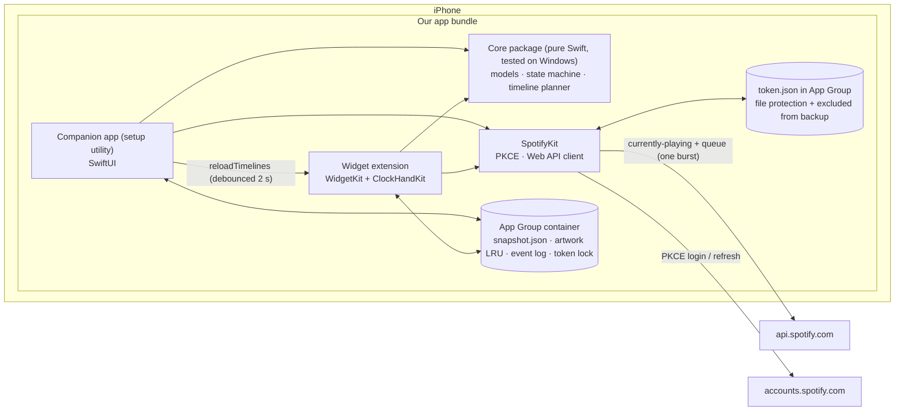
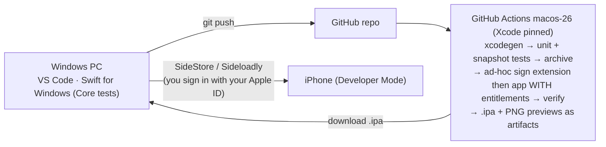

# Vinyl widget for Spotify: feasibility report and recommended architecture

Phase 1 output, 2026-11-11. **Revision 2:** incorporates the QA review [07-qa-review.md](research/07-qa-review.md): blocker B1, majors M1–M11 and most minors. **Revision 3 (owner decision):** the widget is the product. The companion app becomes a setup utility with no vinyl of its own, and the Spotify iOS SDK (App Remote) is dropped.

Synthesised by the architecture lead from six specialist reports, which hold every citation and VERIFIED/INFERRED label:

| # | Report | Topic |
|---|---|---|
| 01 | [research/01-ios-architecture.md](research/01-ios-architecture.md) | WidgetKit, Live Activities, background execution, free-provisioning capabilities |
| 02 | [research/02-spotify-integration.md](research/02-spotify-integration.md) | iOS SDK / App Remote, Web API, OAuth, 2026 Development Mode rules, branding policy |
| 03 | [research/03-design-system.md](research/03-design-system.md) + [../design/vinyl-prototype.html](../design/vinyl-prototype.html) | Design system, wireframes, Spotify artwork rules, interactive prototype |
| 04 | [research/04-animation.md](research/04-animation.md) | Widget rotation (private effect), in-app Core Animation, motion specs |
| 05 | [research/05-battery-performance.md](research/05-battery-performance.md) | Refresh strategy, image pipeline, energy, measurement plan |
| 06 | [research/06-build-infrastructure.md](research/06-build-infrastructure.md) | Windows → cloud macOS CI → iPhone; free vs paid signing |
| 07 | [research/07-qa-review.md](research/07-qa-review.md) | Adversarial QA review of revision 1 |

**📱 Device test** marks claims that can only be settled on your iPhone; they are scheduled as milestone exit criteria in §10.

> **Corrections to the original brief**
> - iOS 27 / Xcode 27 shipped in September 2026, so iOS 27 is current.
> - **Deployment target: iOS 26.0.** CI simulators are iOS 26.x only, so older versions would ship untested. We will lower it to 18.0 if your phone is older.

---

## 1. Verdict

**The product is feasible from Windows. The only unavoidable cost is a Spotify Premium subscription**, under Spotify's 2026 Development Mode rule. If you already have Premium, the marginal cost is $0.

- **The widget is the product.** The companion app is a setup utility: connect Spotify, static widget preview, "Refresh widget now", settings and diagnostics. It has no spinning vinyl of its own (owner decision, revision 3).
- **On the home-screen widget the vinyl spins continuously, but only via a private WidgetKit effect.**
  - It works on iOS 26.1+/27 per community reports, and our exact build/runtime pairing still needs a device test.
  - It is not App Store-eligible.
  - It may be switched off by a future iOS update, in which case the widget falls back to a static disc.
- **The weak point is data freshness, not animation.** iOS gives no app a push signal when Spotify changes track or pauses unless our app is in the foreground. The widget therefore works from a schedule:
  1. **Predict:** it fetches the current track plus Spotify's queue, and switches the label at each predicted track boundary. This keeps uninterrupted listening correct between reloads.
  2. **Reload:** it re-checks about every 10 minutes.
  3. **Tap:** its refresh/play-pause button updates it immediately.
- **Limitation:** a pause or skip made in Spotify reaches the widget at the next reload or tap.

## 2. Answers to the ten Phase 1 questions

| # | Question | Answer | Src |
|---|---|---|---|
| 1 | Can a third-party home-screen widget continuously rotate a vinyl? | **Conditionally yes.** Public WidgetKit cannot: views are archived snapshots, and animation is ≤ 2 s between entries. The private WidgetKit type `_ClockHandRotationEffect` (used by clock widgets) rotates a view continuously, rendered by the system as a function of wall-clock time. The open-source **ClockHandKit** (MIT, one source file) builds it at runtime. It is reported working on iOS 26.1+ (built with Xcode 26.1) and on iOS 27 (built with Xcode 27.0; author + one user). **Our CI's Xcode 26.6 → iOS 27 pairing is untested.** It is the first M0 spike. Apple DTS calls the technique unsupported and warns it "can cause battery drain". | 01, 04, 07 |
| 2 | Closest alternative if not? | Static disc, plus a ≤ 2 s rotation transition on track change and a live `ProgressView(timerInterval:)` progress ring. This is also the automatic fallback. | 04 |
| 3 | Can Spotify playback state be accessed reliably? | **Yes, via the Web API** (`currently-playing`, `queue`). It is request/response, callable from both the widget and the app, and confirmed available to new Development Mode apps. The event-driven **App Remote** SDK also exists, but it only works while our app is in the foreground, so it is **not used** now that the app has no player screen (revision 3). | 02 |
| 4 | Detect song changes? | Opening the app refreshes the widget immediately. **Widget:** uninterrupted listening is predicted from the queue (📱 device test that entries render on time). Skips are caught at the next reload (~10 min) or on a refresh tap. | 02, 05, 07 |
| 5 | Detect pause/resume? | Opening the app refreshes the widget immediately. **Widget:** a pause is seen at the next reload or tap; until then the disc keeps spinning, bounded by the "last seen" stop (§4.7). A resume is seen at the next paused-state reload (≤ 30 min) or tap. | 02, 07 |
| 6 | Without running continuously in the background? | **Yes, and we never run in the background.** No background audio, location or BGAppRefresh polling. The app makes one fetch when opened and nothing after it leaves the foreground. | 01, 05 |
| 7 | Develop entirely from Windows? | **Yes.** Edit in VS Code. A Foundation-only SwiftPM `Core` package unit-tests locally with Swift for Windows. All iOS compilation, simulator tests and rendered PNG previews of every widget state run on GitHub Actions `macos-26`. One iteration takes about 8–15 min per CI job. | 06 |
| 8 | Install without a Mac? | **Yes.** CI produces an `.ipa` ad-hoc signed with our entitlements. **SideStore** (refreshes on the phone) or **Sideloadly** (refreshes from your PC) re-signs it with a **free Apple ID**, which you sign in with yourself. Limits: 7-day signatures; 3 apps per device, with SideStore itself using one; 10 App IDs per week, of which we use 2. | 06 |
| 9 | Unavoidable costs? | **Spotify Premium only.** Since February 2026, Development Mode apps stop working unless the app owner has active Premium. | 02 |
| 10 | Free vs Premium differences? | The **owner** must have Premium, or the Client ID stops working for everyone. Allowlisted *users* (≤ 5) can be Free: they can read playback, but play/pause control returns 403 and ads appear as "Advertisement". You are the owner, so Premium is required. | 02 |

## 3. Feasibility matrix

| Feature | Feasibility | Limitations | Recommended solution |
|---|---|---|---|
| Spotify metadata | ✅ Yes | Owner needs Premium. Refresh tokens die after 6 months (re-login). Unpublished daily quota. Podcasts, ads, local files and Private Session need special states. | Web API `currently-playing` + `queue` (widget and app); PKCE, no client secret |
| Album artwork | ✅ Yes, with a policy caveat | Spotify: "Don't crop the artwork", "Don't animate or distort it". A spinning circle crop breaks both. | **Full-bleed** circle crop is the only label style. The owner, as the sole user, accepted the policy risk (§8). |
| Playback detection | ⚠️ Widget | Widget is not notified of pauses or skips | Queue prediction + ~10 min reloads + refresh button; opening the app refreshes instantly |
| Widget correctness during continuous listening | ⚠️ 📱 Device test | Depends on WidgetKit rendering entries closer than Apple's ~5 min guidance on time, and on Spotify's queue reflecting shuffle/autoplay | 3-hour listening run in M4, logged by Diagnostics |
| Continuous vinyl rotation | ⚠️ Widget only (by choice) | Private path: may break, not App Store-safe, no spin-up/down inertia, ticks in Low Power Mode | ClockHandKit with static fallback; user setting On / Only when charging / Off |
| Home-screen widget | ✅ Yes | Art is small on small widgets. Tinted/clear modes need `.widgetAccentedRenderingMode(.fullColor)`. Buttons are inactive while the phone is locked. | Small (record + play/pause) and Medium (record, track/artist, play/pause + skip), as in the prototype. Large and Lock Screen later. |
| Live Activity | ⚠️ Possible, **not in v1** | ≤ 2 s animations, no network of its own, stale on every track change without APNs push (paid + a server), duplicates Spotify's own Now Playing | Defer; revisit only if a device test shows rotation working there |
| Low battery usage | ⚠️ **Unknown until measured** | App and network design are low-cost by construction. Widget-spin render cost is unmeasured, and Apple DTS warns it "can cause battery drain". No parity claim with MD Vinyl. | Measurement plan §7; spin is a user setting |
| Windows development | ✅ Yes | No local SwiftUI compile; loop is ~8–15 min on CI | XcodeGen + GitHub Actions; Swift for Windows for `Core` |
| iPhone installation | ✅ Yes (free) | 7-day re-sign. Developer Mode required. iTunes/iCloud must come from Apple's site. AltStore/SideStore rewrite App Group IDs; Sideloadly's handling is undocumented. | SideStore primary, Sideloadly backup; runtime App Group discovery; expiry warning badge |

## 4. Recommended architecture

### 4.1 Components



| Component | Responsibility | Why |
|---|---|---|
| `Core` (SwiftPM, Foundation-only) | `NowPlaying` model, playback state machine, **timeline planner** (queue prediction, reload dates, last-seen stop), cache index, rate limiter | Compiles and tests **on Windows**, so the riskiest logic gets a fast local loop |
| `SpotifyKit` | PKCE login, token store with single-writer refresh, Web API client (8 s timeout, no retries inside a timeline build) behind a protocol with a fake for CI | Official mechanisms only; testable without Spotify |
| Companion app (setup utility) | Connect Spotify, static widget preview, "Refresh widget now", settings, **Diagnostics** (request/reload log, resolved App Group & bundle ID, effect-availability probe, signature expiry) | SwiftUI. Fetches once when opened and reloads the widget (not budgeted while in the foreground). No animation, no background work. |
| Widget extension | **Reads the App Group snapshot first; if it is < 60 s old, no network call.** Otherwise one Web API burst. Builds the predicted timeline. **Play/pause + skip** `Button(intent:)`: every tap also reloads the widget (unbudgeted), so anything done from the widget shows immediately. After a skip, use the queue's next track or a short re-fetch delay, because Spotify reports the change with a lag. | WidgetKit is the only home-screen surface; intent reloads are unbudgeted (VERIFIED) |
| ClockHandKit (vendored, MIT) | Continuous widget rotation | Only known working path in 2026; source, not binary |

### 4.2 Data flow

```mermaid
sequenceDiagram
  participant A as Companion app (foreground)
  participant G as App Group
  participant W as Widget extension
  participant API as Spotify Web API

  Note over A: App opened (or "Refresh widget now" tapped)
  A->>API: GET currently-playing + GET queue (one burst)
  A->>G: write snapshot + art
  A->>W: reloadTimelines (not budgeted while foreground)
  Note over A: nothing runs after the app leaves the foreground

  Note over W,API: App closed
  W->>G: snapshot < 60 s old? → use it, no network
  W->>API: GET currently-playing + GET queue (one radio burst)
  W->>W: fetch art only for albums not in cache (CDN)
  W-->>W: timeline: label changes at each predicted track boundary<br/>→ "last seen" stopped entry at nextReload + grace
  Note over W: refresh / play-pause tap → App Intent → immediate reload (unbudgeted; not while locked)
```

### 4.3 Authentication and token storage

- **Login:** PKCE via `ASWebAuthenticationSession`, custom URL scheme redirect, handled with `onOpenURL` (iOS 27 requires the scene life cycle). No client secret anywhere.
  - **Fallback if Spotify rejects the scheme:** an HTTPS bounce page on GitHub Pages.
- **Scopes, all requested at first login** (adding one later forces a re-login): `user-read-currently-playing`, `user-read-playback-state`, `user-modify-playback-state`.
- **Token storage (owner decision, revision 3):** a **protected file** in the App Group container.
  - Protection class `NSFileProtectionCompleteUntilFirstUserAuthentication`, so widgets can read it while the phone is locked after first unlock.
  - Marked `isExcludedFromBackup`, so it never reaches iCloud or computer backups.
  - Readable only by this app and its widget (iOS sandbox).
  - It holds only the scoped Spotify token, never a password. You can revoke it at spotify.com → Account → Manage apps.
  - **Why not the Keychain:** the shared Keychain's survival across weekly re-signing is unproven. The security difference on a single-user phone is small.
- **After a restart, before first unlock,** reads fail with `errSecInteractionNotAllowed`. Treat that as *temporarily unavailable*: keep the archived timeline, retry in 15 min, and **never** clear tokens or show "Reconnect".
- **Refresh:** single writer. Take a lock file in the App Group, re-read the token, refresh only if it is still expired, then write. This matters because refresh tokens may rotate.
- **Expiry:** after 6 months a refresh returns `invalid_grant`, and the app and widget show "Reconnect Spotify".
- **Switching re-signer, Apple ID or team** changes the App Group ID, so it costs one re-login. Diagnostics shows the resolved group.

### 4.4 Animation

| Surface | Mechanism | Behaviour |
|---|---|---|
| App | None: a static widget preview only (revision 3). A Core Animation player screen (designed in report 04) can be added later without rework. | — |
| Widget | ClockHandKit `.custom(3.6)` (16⅔ RPM default; 33⅓ selectable) on the label layer only | Angle is a function of wall-clock time, so no reset on reloads or track changes (calibrate the epoch on device). **Static** when: paused; Reduce Motion; Always-On / `isLuminanceReduced`; Low Power Mode (read at timeline build, best effort); thermal ≥ serious; or user setting Off / "only when charging". Resume uses a ≤ 2 s fade. |
| Live Activity | Not in v1 | — |

**Composition:** grooves are rotationally symmetric, so only the label and fine "etch" marks rotate, under a **static** specular sheen. This reads as a real record under a fixed lamp, and only one small bitmap rotates.

### 4.5 Image caching

- **Widget:** Web API 300 px image; the 640 px image only for sleeve art > 100 pt.
  - Downsampled with ImageIO to the family's pixel size, staying under the ~700k-pixel archive limit.
  - Stored in the App Group keyed by album ID.
- **LRU:** ≤ 25 MB / 100 albums, entries expire after 7 days (Spotify Terms: no indefinite caching), purged on sign-out.
- No `AsyncImage` in the widget. Widget peak-memory target ≤ 15 MB.
- **Bundled fallback disc assets** mean a first-run or offline widget is never blank.

### 4.6 Build and deployment pipeline



- **Entitlements must be embedded.** A plain unsigned build drops them, so the re-signer would drop the App Group and the widget would go blank.
- **App Group discovery at runtime:** both targets try these in order, accepting the first whose container URL is non-nil:
  1. `ALTAppGroups` in Info.plist
  2. `embedded.mobileprovision`
  3. the compiled-in ID
- **Group ID ≠ bundle ID.** SideStore has a special case for groups that equal the bundle ID, so we avoid that.

### 4.7 Widget timeline policy by state

| State | Timeline entries | Reload policy |
|---|---|---|
| Playing | Current track (spinning). **One entry per predicted track boundary from the queue**, each with its own label. Then a **"last seen"** entry at `nextReload + 2 min` grace (static disc, caption `Text(lastFetch, style: .relative)`). If no queue: keep the current label until "last seen". | `.after(now + 10 min)`, tunable in M4. In Low Power Mode, `.after(now + 15 min)`. |
| Paused | Static disc at frozen angle, "Paused" | `.after(now + 30 min)` for 2 h, then `.after(now + 2 h)`. Never `.never`, so a resume is eventually seen. |
| Idle (204 / nothing playing) | Idle disc | `.after(now + 60 min)` |
| Offline / 5xx / timeout | Last snapshot, marked "last seen" | `.after(now + 30 min)` |
| 429 | Last snapshot | `.after(max(now + 30 min, Retry-After))`; on `QUOTA_EXCEEDED`, a 24 h cooldown |
| Before first unlock | Archived timeline untouched | `.after(now + 15 min)` |
| `invalid_grant` / signed out | "Reconnect Spotify" | `.never` (the app reloads after login) |

**Worst cases, stated honestly:**
- **After a pause in Spotify:** the disc keeps spinning ≤ ~12 min, unless you tap refresh or open the app.
- **After the reload budget is exhausted** (behaviour undocumented; 📱 measure it): the disc stops at "last seen" and says so. It never keeps spinning on stale data.

**Budget arithmetic.** Playing reloads at ~6/hour fit 40–70/day for roughly 7–11 listening hours. Apple calls 40–70 a typical rate, not a guarantee.

### 4.8 Edge states

These follow report 03's state tables, with QA amendments.

| Situation | App | Widget |
|---|---|---|
| Missing art / local file | Neutral label + ♪ | Same; never show the previous album's art for a new track |
| Art download fails (8 s timeout) | Cache, else neutral label | Neutral label; timeline not blocked; retry next reload |
| Ad | "Advertisement", neutral label | Same |
| Podcast episode | Episode art in preview | Episode art + title |
| Spotify not running | "Open Spotify" button (never auto-plays) | Idle state after next reload |
| Offline | "Offline" status; last snapshot shown | "Last seen" state |
| Signature expiring (≤ 2 days) | Banner with expiry date (from `embedded.mobileprovision`) | Small badge |
| Free-tier user | Play/pause disabled | Refresh-only button |

**Attribution:** Spotify logo + "OPEN SPOTIFY" link-back on every surface. The whole-widget tap deep-links to Spotify. The app's name must not start with "Spot".

## 5. Conflicts between reports and their resolutions

| Conflict | Reports | Resolution |
|---|---|---|
| Static widget design vs private-effect spin | 03 vs 04 | ClockHandKit spin; the static design is the fallback and the paused state |
| Shared Keychain vs "never share; team prefix changes" | 02 vs 06 | Access group = runtime App Group ID (Apple-documented); file fallback; 📱 M1 |
| ~25 req/h vs ≤ 12/h background and 0 in app | 02 vs 05 | Battery wins. App: App Remote events. Widget: 60 s freshness check + one burst per ~10 min reload. |
| Stop-entry timing (at track end vs +10 min); rev 1 invented +20 s | 04, 05, 07 | Queue prediction, then "last seen" at `nextReload + grace` (§4.7) |
| Paused/idle policy (15–60 min / `.never`) | 01, 02, 05 | §4.7 table; never `.never` while signed in |
| 3-min stale rule vs ≥ 5-min reloads | 03 vs 01/05 | Stale = past `nextReload + grace` |
| Offline → spin down vs App Remote works offline | 03 vs 02 | Trust App Remote while connected |
| Widget tap opens Spotify; no button vs intent button for freshness | 03 vs 01/05 | Disc/art area deep-links to Spotify; a 28 pt refresh/play-pause button in the status slot (03 to update wireframes) |
| App engine: TimelineView/CADisplayLink vs Core Animation | 03 vs 04/05 | Core Animation; 03's spin curves approximated with keyframes |
| Inertia and RPM | 03 vs 04 vs 05 | App 33⅓ RPM, 0.65 s / 1.6 s (03, tunable). Widget 16⅔ default (04) with 33⅓ option. |
| Art size: 300 px vs App Remote 600 px vs sleeve sizes | 05 vs 02 vs 03 | §4.5 per-surface sizes |
| SDK: SPM vs vendored | 06 vs 02 | SPM; vendor only if #465 bites |
| Deployment target: 17 / 18 / 26 | 01, 04, 05, 06 | iOS 26.0 (matches CI simulators) |
| Live Activity | 01, 05 | Not in v1 |

Revision 3 removed App Remote and the in-app player. Rows above that mention them (offline handling, app engine, in-app inertia, art sizes from App Remote, SDK packaging) are kept as history and no longer affect v1.

## 6. Expected behaviour for the 12 required test scenarios

The widget is the product, so expected behaviour is defined for the widget. Opening the app, or tapping the widget's refresh button, always forces an immediate correct update.

| # | Scenario | Widget |
|---|---|---|
| 1 | Spotify starts playing | Next reload (idle: ≤ 60 min) or tap / app open; then spins |
| 2 | Track changes | Uninterrupted: the predicted entry switches the label on time (📱). Skip: next reload (≤ 10 min) or tap |
| 3 | Paused | Next reload or tap; worst case ≤ ~12 min still spinning, then "last seen" |
| 4 | Resumed | Paused-state reload ≤ 30 min (first 2 h) or tap; ≤ 2 s fade into spin |
| 5 | Spotify closed | Idle after next reload; until then the "last seen" bound applies |
| 6 | Internet lost | "Last seen" state; retry in 30 min |
| 7 | Artwork fails | Neutral label + ♪; timeline unaffected |
| 8 | Companion app terminated | Unaffected: the widget runs on its own |
| 9 | iPhone restarts | Archived timeline shown. Before first unlock there is no token access, so it waits and never shows "Reconnect". Recovers at the next reload; spin phase unchanged. |
| 10 | Widget removed/re-added | Fresh fetch (or cache hit); bundled fallback disc if the cache is empty; same phase |
| 11 | Low Power Mode | Static disc, 15 min reload floor (📱 confirm LPM tick behaviour) |
| 12 | Free vs Premium | Owner without Premium: the app shows an explicit "Premium required" screen (403). Free allowlisted user: refresh button only, play/pause disabled; ads → neutral label |

## 7. Battery-performance analysis (design-time; **not measured**)

| Activity | Cost driver | Design |
|---|---|---|
| Network | Radio wake-ups (~10 s high-power tail per burst on cellular), not bytes | One burst per reload (2 small JSON calls + art only for new albums). ≤ ~70 budgeted reloads/day per widget instance, plus user taps; the 60 s freshness check dedupes instances and app-triggered reloads. App: one burst per open. |
| Widget spin | System render server, no per-frame work in our process; real cadence unknown; may hold the display at higher refresh; Apple DTS warns of drain | Static when paused, in LPM, Always-On, or Reduce Motion. **User setting: On / Only when charging / Off**; the default is decided by the A/B measurement below. |
| App | One fetch burst when opened; no animation | — |
| Background | None | No audio session, location or BGAppRefresh; nothing runs after the app leaves the foreground |
| Images | One decode/downsample per album | ImageIO thumbnailing; ≤ 15 MB widget peak |

**Measurement plan.** Settings › Battery (per-app usage), plus the app's simple request/reload log. There is no MetricKit screen (owner decision).

| Item | Detail |
|---|---|
| Configurations | (a) our widget with spin on, (b) our widget with spin off, (c) MD Vinyl, (d) no widget |
| Fixed conditions | Same phone, same playlist, same brightness; Wi-Fi and cellular; alternating days; ≥ 3 runs each |
| Known limits | 1% battery-gauge resolution; widget rendering may be billed to the system rather than to either app |

**We will report measured numbers, not parity claims.**

## 8. Compromises (explicit)

1. **Widget awareness of pauses and skips is delayed.**
   - Uninterrupted listening is predicted from the queue.
   - Pauses and skips made in Spotify reach the widget at the next reload (~10 min) or a refresh tap.
   - Refresh buttons don't work while the phone is locked.
   - Only APNs push (paid account + a server we'd operate) could narrow this, and Apple budgets widget pushes too.
2. **Widget spin uses a private API.** It is fine for sideloaded personal use, but not App Store-eligible. An iOS update may switch it off, leaving a static but correct disc.
3. **No spin-up/down inertia.** The widget switches between spinning and still, with a ≤ 2 s fade.
4. **Artwork vs Spotify's guidelines.** The only label style is a full-bleed circle crop. It breaks "Don't crop" and arguably "Don't animate"; the owner, as the sole user, accepted this.
   - The realistic risk for a single-user, non-commercial, sideloaded app is low; the worst case is Spotify revoking the Client ID.
5. **No Live Activity in v1.**
6. **Free Apple ID: re-sign every 7 days.** SideStore refreshes on the phone; Sideloadly over Wi-Fi from the PC. If you miss it, the app and widget stop until you re-sign. An expiry banner warns 2 days ahead.
7. **No vinyl inside the app** (owner decision). The app is a setup utility; a full-screen player can be added later without rework.

## 9. Costs

**Required**

| Item | Cost |
|---|---|
| Spotify Premium | Your subscription (price varies by country; not researched) |
| Spotify developer app (Development Mode, ≤ 5 users) | Free |
| Apple ID (free provisioning) | Free |
| GitHub Actions macOS | Free for a **public** repo, unlimited. A private repo on the Free plan gets $12/month credit, about 190 macOS min or ~15–20 builds. |
| VS Code, Swift for Windows, XcodeGen, SideStore / Sideloadly, iTunes for Windows | Free |

**Optional paid**

| Item | Cost | What it buys |
|---|---|---|
| Apple Developer Program | $99/yr | 1-year signing, TestFlight install, APNs push (could enable push-updated widgets/Live Activity, but needs a server) |
| GitHub Pro / more Actions minutes | Varies | More private-repo build minutes |
| Codemagic beyond 500 free min/month (personal accounts) | Pay-as-you-go | Backup CI capacity |

## 10. Implementation roadmap

| Milestone | Scope | Exit criteria |
|---|---|---|
| **M0 Pipeline + spikes** | Repo, XcodeGen manifest, app + widget + App Group, CI producing an entitlement-correct `.ipa` + PNG previews; `Core` package with Windows tests. **Spike:** ClockHandKit sample built with Xcode 26.6 *and* the xcode-27 preview image. | 📱 Installs via SideStore/Sideloadly. Developer Mode appears after Windows pairing. Diagnostics shows the same resolved App Group in app and widget. Record which Xcode build spins on your iOS version, and pin it in CI. |
| **M1 Spotify auth + data** | PKCE, token store (protected App Group file), single-writer refresh, Web API client incl. `queue`, error states (403 no-Premium, 401, 429, `invalid_grant`, before-first-unlock) | 📱 Log in; widget fetches currently-playing + queue; tokens readable from the widget while locked; owner allowlisting confirmed |
| **M2 Vinyl renderer** | Pre-rendered disc (grooves, etch, static sheen), label modes, art pipeline + LRU, bundled fallback assets | Snapshot PNGs match the prototype |
| **M3 Companion app (setup utility)** | Connect-Spotify onboarding, static widget preview, "Refresh widget now", settings, Diagnostics | 📱 Opening the app updates the widget within seconds. Diagnostics show reloads, requests, signature expiry and spin-effect status. |
| **M4 Widget** | Small (record + play/pause) + Medium (record, track/artist, play/pause + skip); timeline planner per §4.7; ClockHandKit + fallback; refresh/play-pause intent; tinted/clear modes; spin setting | 📱 Measure render cadence. **3-hour continuous-listening run:** % of time with the correct track and spin state, from the Diagnostics log. Confirm LPM behaviour and budget-exhaustion behaviour. |
| **M5 Optimisation** | Request/energy audit (reload log + Settings › Battery), LPM/thermal, widget memory | Targets met: ≤ 100 requests/day, widget ≤ 15 MB |
| **M6 QA + docs** | All 12 scenarios (§6) expected vs actual, incl. Free-tier test with a second allowlisted account; let the signature expire and re-sign; deployment guide; troubleshooting | All scenarios documented; known limitations listed |

## 11. Top risks

| Risk | Likelihood | Mitigation |
|---|---|---|
| No Spotify Premium, or it lapses → Client ID stops working | Blocker if absent | Confirm now; explicit error screen |
| Apple neuters the private rotation effect again | Medium–high within 12 months | Static fallback; build flag to compile it out; watch ClockHandKit/octree trackers each iOS beta |
| Build SDK / runtime pairing disables the effect | Medium | M0 spike; CI matrix; effect probe in Diagnostics |
| Dense predicted entries (< 5 min apart) don't render on time | Medium | 📱 M4 test; fallback: keep the current label until "last seen" |
| Custom URL scheme rejected for new Client IDs | Low–medium | HTTPS bounce page |
| Re-signer differences (Sideloadly App Groups undocumented) | Medium | Runtime group discovery; SideStore primary |
| Missed weekly re-sign → app + widget dead | Medium (weekly) | Expiry banner/badge; SideStore on-device refresh |
| Moving CI to the Xcode 27 SDK | Low | SwiftUI `App` life cycle + `onOpenURL` from day one |
