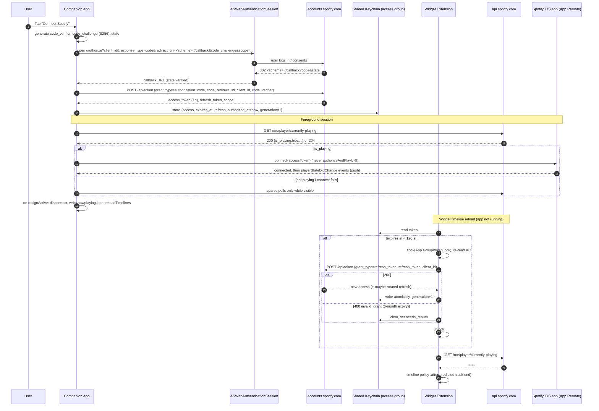

# 02 — Spotify Integration Research (Phase 1)

Author: Agent 2 (Spotify Integration Specialist) · Date: 2026-11-11 · Status: research only, no app code

Labels: **VERIFIED** means the claim is stated in the cited primary source (Spotify docs, blog, changelog, or the spotify/ios-sdk repo). **INFERRED** means it is my reasoning, a community or secondary report, or something the docs leave out. Every INFERRED item should be checked on-device in Phase 2.

---

## 0. TL;DR

1. **A Development Mode app created today requires the app owner to have Spotify Premium.** If the subscription lapses, the app stops working until the owner resubscribes. The app is limited to 5 allowlisted users. Quota is counted per developer account; the July 2026 update allows up to 25 Client IDs per account. **VERIFIED** ([migration guide](https://developer.spotify.com/documentation/web-api/tutorials/february-2026-migration-guide), [quota modes](https://developer.spotify.com/documentation/web-api/concepts/quota-modes), [Feb-2026 blog](https://developer.spotify.com/blog/2026-02-06-update-on-developer-access-and-platform-security), [Jul-2026 blog](https://developer.spotify.com/blog/2026-07-23-web-api-quota-updates)). **If the developer does not have Premium, the project is blocked.** Extended Quota is open only to registered organisations with at least 250k MAU, so it is not an option for us.
2. **The player read endpoints are still available in Development Mode:** `GET /me/player` and `GET /me/player/currently-playing`. **VERIFIED** ([Feb-2026 changelog, "Endpoints still available"](https://developer.spotify.com/documentation/web-api/references/changes/february-2026)).
3. **Refresh tokens now expire 6 months after the user authorizes**, and refreshing does not extend that lifetime. After that, the token endpoint returns `400 invalid_grant` and the user must sign in again. This took effect for new apps on 2026-06-18. **VERIFIED** ([blog 2026-06-18](https://developer.spotify.com/blog/2026-06-18-refresh-token-expiration)). The widget therefore needs a "Reconnect Spotify" state.
4. **There is a daily quota in Development Mode** (`429` with `"reason":"QUOTA_EXCEEDED"`). The bucket sizes are not published. One community report estimates about 25–28k requests per day, after being exhausted by 3-second polling. Our design should use fewer than 100 requests per hour. Existence of the quota: **VERIFIED**. The figure: **INFERRED** ([changelog Jul-2026](https://developer.spotify.com/documentation/web-api/references/changes/july-2026), [LoupixDeck issue #15](https://github.com/RadiatorTwo/LoupixDeck.Plugin.SpotifyPremium/issues/15)).
5. **The Web API has no push, webhook or event mechanism.** App Remote is the only event-driven option, and it works only while our app is in the foreground and the Spotify app is alive. **VERIFIED** that no such Web API feature is documented; "none exists" is **INFERRED**, because the docs only show its absence.
6. **Spotify's design guidelines say "Don't crop the artwork in any way" and "Don't animate or distort it".** A spinning, circular-cropped vinyl label breaks both rules as written. This is a policy risk we need to mitigate (§5), not a technical blocker.
7. **Recommended design:** a single PKCE sign-in through our own `ASWebAuthenticationSession`, or through `SPTSessionManager` with `playURI = nil`. Use App Remote **only while the app is in the foreground, and only if Spotify is already running**; never call `authorizeAndPlayURI`. The widget reads the Web API from its TimelineProvider and schedules reloads at the predicted end of each track. Tokens live in a shared Keychain access group, and refreshes go through a single-writer lock.

---

## 1. iOS SDK / App Remote

### 1.1 Version, distribution, minimum iOS
| Item | Finding | Status / Source |
|---|---|---|
| Latest version | **v5.0.1**, published 2025-08-13. The previous release was v3.0.0 (2024-10-03); v4.0.x and v5.0.0 appear only in the CHANGELOG. There has been no release in 2026. | VERIFIED: [GitHub releases API](https://api.github.com/repos/spotify/ios-sdk/releases), [CHANGELOG](https://github.com/spotify/ios-sdk/blob/master/CHANGELOG.md) |
| Distribution | `SpotifyiOS.xcframework` (drag-in) **or Swift Package Manager** (`Package.swift` in the repo root). CocoaPods is not documented. Open issue #465 reports an SPM identity clash caused by the generic repo name `ios-sdk`. | VERIFIED: [README](https://github.com/spotify/ios-sdk), [issue #465](https://github.com/spotify/ios-sdk/issues/465) |
| Minimum iOS | **iOS 12**. Device slice is arm64; simulator slices are arm64 and x86_64. The SDK only works on a physical device because Spotify cannot be installed on the simulator. | VERIFIED: [README](https://github.com/spotify/ios-sdk), [iOS overview](https://developer.spotify.com/documentation/ios), [Getting started](https://developer.spotify.com/documentation/ios/getting-started) |
| Threading | "the framework currently expects to be called from the main thread" | VERIFIED: [README](https://github.com/spotify/ios-sdk) |
| Maintenance health | Releases are slow. Several 2026 issues have no maintainer reply, for example #474, where auth returns `unknown_error` even in the demo app (the author closed it with no recorded fix). #467 reports a crash when `can_play_on_demand` is null. | VERIFIED: [issues list](https://github.com/spotify/ios-sdk/issues) |
| CI build | It is a binary xcframework, so cloud CI (GitHub Actions macOS runners) can link it without trouble. Agent 1/3 should confirm it works with the Xcode 26 toolchain. | INFERRED |

### 1.2 Player-state data delivered
`SPTAppRemotePlayerState`: **VERIFIED** from the [header](https://github.com/spotify/ios-sdk/blob/master/SpotifyiOS.xcframework/ios-arm64/SpotifyiOS.framework/Headers/SPTAppRemotePlayerState.h)
- `track` (`SPTAppRemoteTrack`), `playbackPosition` (NSInteger, ms), `playbackSpeed` (float), `isPaused`, `playbackRestrictions`, `playbackOptions` (shuffle/repeat), `contextTitle`, `contextURI`.

`SPTAppRemoteTrack`: **VERIFIED** from the [header](https://github.com/spotify/ios-sdk/blob/master/SpotifyiOS.xcframework/ios-arm64/SpotifyiOS.framework/Headers/SPTAppRemoteTrack.h)
- `name`, `URI`, `duration` (ms), `artist` (name/URI), `album` (name/URI), `isSaved`, `isEpisode`, `isPodcast`, `isAdvertisement`. It conforms to `SPTAppRemoteImageRepresentable`, which provides `imageIdentifier`.

Images: **VERIFIED** from the [`SPTAppRemoteImageAPI.h`](https://github.com/spotify/ios-sdk/blob/master/SpotifyiOS.framework/Headers/SPTAppRemoteImageAPI.h) header
- `fetchImageForItem:withSize:(CGSize)callback:` returns a `UIImage` that the Spotify app provides over the local connection, so it costs no Web API call. The header says nothing about which sizes are supported. **INFERRED:** you request any `CGSize` and the Spotify app returns its closest cached rendition, which in practice is up to about 640 px. Request around 600×600 px for a sharp vinyl label on 3x devices, and check the actual pixel size on a device.

### 1.3 Event-driven or not?
- **Push-based. VERIFIED:** `subscribeToPlayerState` combined with `SPTAppRemotePlayerStateDelegate.playerStateDidChange:` ("Called when the player state has been updated"). The PlayerAPI header notes say to set the delegate "to be notified when the track changes", "...when the playback pauses" and "...when the playback resumes" ([SPTAppRemotePlayerAPI.h](https://github.com/spotify/ios-sdk/blob/master/SpotifyiOS.xcframework/ios-arm64/SpotifyiOS.framework/Headers/SPTAppRemotePlayerAPI.h)). Track change, pause and resume therefore all arrive as events.
- **INFERRED:** events are not sent for normal playback progress. Extrapolate the position locally from `playbackPosition` and the timestamp of receipt. A seek produces an event.

### 1.4 Connection lifecycle
| Scenario | Behaviour | Status / Source |
|---|---|---|
| Our app goes to background | Spotify asks you to **disconnect when your app resigns active and reconnect when it becomes active** ("As a courtesy, you should always disconnect App Remote when your app enters a background state"). No timing is documented. In practice iOS suspends our process within seconds, so the socket dies anyway. | VERIFIED: [README](https://github.com/spotify/ios-sdk), [Application lifecycle](https://developer.spotify.com/documentation/ios/concepts/application-lifecycle) |
| Spotify app not running | `connect`: "If the Spotify app is not running you will need to use authorizeAndPlayURI: to wake it up". Waking Spotify always requires an app switch. | VERIFIED: [SPTAppRemote.h](https://github.com/spotify/ios-sdk/blob/master/SpotifyiOS.xcframework/ios-arm64/SpotifyiOS.framework/Headers/SPTAppRemote.h), [lifecycle](https://developer.spotify.com/documentation/ios/concepts/application-lifecycle) |
| Spotify running but paused | The README FAQ says music must be playing when you connect, so that Spotify is not suspended in the background. The lifecycle doc says "an app switch is required to resume playback when the user pauses the music". **INFERRED:** if the user has been paused for a while, Spotify gets suspended and `connect` fails, so we fall back to the Web API. | VERIFIED: [README](https://github.com/spotify/ios-sdk), [lifecycle](https://developer.spotify.com/documentation/ios/concepts/application-lifecycle) |
| Does connecting start playback? | `connect()` does not. `authorizeAndPlayURI:` **does**: "The passed URI will start playing unless Spotify is already playing", and "Use a blank string to attempt to play the user's last song". Getting started adds: "If empty, it will resume playback of user's last track or play a random track." **Never call `authorizeAndPlayURI` automatically**, because our app must not start music on its own. | VERIFIED: [SPTAppRemote.h](https://github.com/spotify/ios-sdk/blob/master/SpotifyiOS.xcframework/ios-arm64/SpotifyiOS.framework/Headers/SPTAppRemote.h), [Getting started](https://developer.spotify.com/documentation/ios/getting-started) |
| Auth without starting playback | `SPTConfiguration.playURI = nil` (or not requesting `app-remote-control`) means no audio plays during authorization. | VERIFIED: [SPTConfiguration.h](https://github.com/spotify/ios-sdk/blob/master/SpotifyiOS.xcframework/ios-arm64/SpotifyiOS.framework/Headers/SPTConfiguration.h) |
| Spotify app installed? | App Remote requires the Spotify app. `SPTSessionManager` auth-only falls back to web auth without it. | VERIFIED: [README FAQ](https://github.com/spotify/ios-sdk) |
| Widget extension using App Remote | **Not viable.** It needs a long-lived main-thread connection and app switches, and extensions run only briefly. | INFERRED |
| Spotify UX guidance | When App Remote is not connected, show an "Open Spotify" / "Resume playback" button. | VERIFIED: [lifecycle](https://developer.spotify.com/documentation/ios/concepts/application-lifecycle) |

---

## 2. Authentication

### 2.1 SPTSessionManager / SPTConfiguration
- **PKCE without a token-swap server is supported.** PKCE is the default exchange method, and the SDK "directly sends a request to the Spotify token exchange endpoint". `tokenSwapURL` and `tokenRefreshURL` are optional and meant for a backend that holds the client secret. **VERIFIED** ([docs/auth.md](https://github.com/spotify/ios-sdk/blob/master/docs/auth.md), [SPTConfiguration.h](https://github.com/spotify/ios-sdk/blob/master/SpotifyiOS.xcframework/ios-arm64/SpotifyiOS.framework/Headers/SPTConfiguration.h)). No client secret ships in the app.
- **A refresh token is returned:** `SPTSession` exposes `accessToken`, `refreshToken`, `expirationDate` and `scope`, and conforms to `NSSecureCoding`. `renewSession` "Attempt[s] to renew the access token, using the refresh token in the current SPTSession". **VERIFIED** for the API surface ([SPTSession.h](https://github.com/spotify/ios-sdk/blob/master/SpotifyiOS.xcframework/ios-arm64/SpotifyiOS.framework/Headers/SPTSession.h), [SPTSessionManager.h](https://github.com/spotify/ios-sdk/blob/master/SpotifyiOS.xcframework/ios-arm64/SpotifyiOS.framework/Headers/SPTSessionManager.h)). **INFERRED:** that `renewSession` works over PKCE with no `tokenRefreshURL`. The docs do not say so; a community report says it does ([forum](https://community.spotify.com/t5/Spotify-for-Developers/PKCE-support-and-example-code-for-iOS-SDK/td-p/5967097)).
- **Recommendation:** do the refresh ourselves with a plain `POST https://accounts.spotify.com/api/token` (`grant_type=refresh_token`, `client_id`, no secret, which is the documented PKCE refresh form: [Refreshing tokens](https://developer.spotify.com/documentation/web-api/tutorials/refreshing-tokens)). The widget extension cannot practically host `SPTSessionManager` (a UIKit/session-scene object), and both processes must share one code path anyway.
- **Optional simplification (INFERRED, test in Phase 2):** skip SDK auth altogether and run standard PKCE in an `ASWebAuthenticationSession`. Then pass the access token to `appRemote.connectionParameters.accessToken`. This avoids the app-switch-to-Spotify auth path, which validates the iOS bundle ID (see §6), and avoids the open `unknown_error` reports in #474. The risk is that App Remote may reject a token minted outside the SDK. The SDK's own PKCE session is a normal OAuth token, so this should work, but it has not been verified.

### 2.2 Can the SDK token be used for the Web API?
- **INFERRED: yes.** An `SPTSession` token is an ordinary accounts.spotify.com OAuth access token carrying whatever scopes were requested. The docs link SDK scopes to the Web API scope list but never say so explicitly ([docs/auth.md](https://github.com/spotify/ios-sdk/blob/master/docs/auth.md)). Request the Web API scopes along with `app-remote-control` in a single authorization.

### 2.3 Scopes (read-only now-playing)
| Scope | Needed for | Status / Source |
|---|---|---|
| `user-read-currently-playing` | `GET /me/player/currently-playing` | VERIFIED: [scopes](https://developer.spotify.com/documentation/web-api/concepts/scopes) |
| `user-read-playback-state` | `GET /me/player` (also accepted on currently-playing) | VERIFIED: [scopes](https://developer.spotify.com/documentation/web-api/concepts/scopes) |
| `app-remote-control` | iOS/Android SDK App Remote | VERIFIED: [scopes](https://developer.spotify.com/documentation/web-api/concepts/scopes) |
| `user-modify-playback-state` | **Do not request it** unless widget play/pause buttons are added. Those controls are Premium-only (§4). | VERIFIED: [scopes](https://developer.spotify.com/documentation/web-api/concepts/scopes) |

### 2.4 Refresh token behaviour (2026 rules)
- Access tokens last 3600 s. **VERIFIED** ([Refreshing tokens](https://developer.spotify.com/documentation/web-api/tutorials/refreshing-tokens)).
- A refresh response "might not" include a new `refresh_token`. If it does not, keep the old one. **VERIFIED** ([Refreshing tokens](https://developer.spotify.com/documentation/web-api/tutorials/refreshing-tokens), [PKCE tutorial](https://developer.spotify.com/documentation/web-api/tutorials/code-pkce-flow)).
- **PKCE refresh tokens rotate in practice:** a new refresh token is returned on each refresh. Community reports suggest the previous one may become invalid. Rotation itself is **INFERRED** ([forum](https://community.spotify.com/t5/Spotify-for-Developers/Refreshing-tokens-for-PKCE-authorised-users/td-p/5023175)). Design for strict rotation: two concurrent refreshes using the same refresh token could log the user out.
- **Hard 6-month lifetime from the original authorization. Refreshing does not reset it.** Expiry produces `400` with `invalid_grant`. Do not retry; send the user back through sign-in. Tokens carry no issue timestamp, so store `authorized_at` yourself. **VERIFIED** ([blog 2026-06-18](https://developer.spotify.com/blog/2026-06-18-refresh-token-expiration)).

### 2.5 Safe single-writer token scheme (app + widget extension)
Storage:
- **Keychain** item in a shared **keychain access group** (`$(TeamID).com.example.vinyl.shared`), with `kSecAttrAccessibleAfterFirstUnlockThisDeviceOnly`, because widgets reload while the device is locked. The payload is JSON: `{access_token, access_expires_at, refresh_token, authorized_at, scopes, generation}`.
- **App Group container** holds `token.lock`, an empty file used for `flock` or `NSFileCoordinator`, plus non-secret state (`nowplaying.json`, the artwork cache).

Algorithm `getValidAccessToken()`, identical in the app and the extension:
1. Read the Keychain. If `access_expires_at - now > 120 s`, return the token without taking a lock.
2. Take an exclusive `flock(token.lock)` with a timeout of about 10 s. A widget has only a few seconds, so on timeout it serves cached state.
3. **Read the Keychain again inside the lock.** If another process has already refreshed it (the `generation` changed and the token is valid), release and return.
4. POST the refresh. On 200, write `{new access, new refresh ?? old refresh, generation+1}` atomically with `SecItemUpdate`, then release.
5. On `400 invalid_grant`: set `needs_reauth = true` in the App Group, clear the tokens, and have the widget render a "Reconnect Spotify" state that deep-links into the app. Also warn in-app when `authorized_at` is more than 5.5 months old.
6. On a network error, release without writing anything. The old refresh token stays valid because nothing was consumed.

The worst case is a crash after Spotify issued a rotated token but before we wrote it. That loses the session and requires a re-login. The window is a few milliseconds, which is acceptable. **INFERRED** design. `flock` on a file in a shared App Group container works across processes on iOS; Agent 1 should confirm with free-provisioning App Groups.

---

## 3. Web API

### 3.1 `GET /v1/me/player/currently-playing` and `GET /v1/me/player`
| Field | Notes | Status / Source |
|---|---|---|
| `timestamp` | "Unix Millisecond Timestamp when playback state was last changed (play, pause, skip, scrub, new song, etc.)". Useful for change detection. | VERIFIED: [ref](https://developer.spotify.com/documentation/web-api/reference/get-the-users-currently-playing-track) |
| `progress_ms` | Nullable. | VERIFIED: same |
| `is_playing` | boolean | VERIFIED: same |
| `item` | Track, episode, or `null` | VERIFIED: same |
| `item.duration_ms`, `item.album.images[]`, `item.is_local` | Images are ordered widest first. **INFERRED:** the usual sizes are 640, 300 and 64 px; the doc example shows only 300. | VERIFIED/INFERRED: same |
| `currently_playing_type` | `track`, `episode`, `ad` or `unknown` | VERIFIED: same |
| `additional_types=episode` | Without it, podcast episodes come back with `item: null`. | VERIFIED (param doc) / INFERRED (null behaviour) |
| `actions` | Shows which actions are disallowed (pausing, skipping, etc.) | VERIFIED |
| `/me/player` extras | `device`, `repeat_state`, `shuffle_state`, `context` | VERIFIED: [ref](https://developer.spotify.com/documentation/web-api/reference/get-information-about-the-users-current-playback) |
| **204** | `/me/player` documents a 204 response, and 204 means "No Content". **INFERRED:** you get 204 when there is no active device or nothing playing, and probably during a Private Session. The currently-playing page does not list 204, but community reports say it occurs. | VERIFIED: [api-calls](https://developer.spotify.com/documentation/web-api/concepts/api-calls) / INFERRED |

Edge cases to handle:
- **Ads (Free tier):** `currently_playing_type=ad` with `item` null. Keep showing the last artwork, or a "spinning blank" record.
- **Podcasts:** `item` is an episode, so use `item.images` (episode or show art).
- **Local files:** `is_local=true`, album images are usually empty, and the URI looks like `spotify:local:...`. Fall back to generic label art. (INFERRED)
- **Development Mode 2026 field removals** affect `popularity`, `available_markets` and similar fields on Track and Album, which we don't use. **Images are not removed.** **VERIFIED** ([migration guide](https://developer.spotify.com/documentation/web-api/tutorials/february-2026-migration-guide)).

### 3.2 Rate limits and quota
- The rate limit is a rolling 30-second window, higher in extended mode. A `429` usually carries `Retry-After`. **VERIFIED** ([rate limits](https://developer.spotify.com/documentation/web-api/concepts/rate-limits)).
- **Development Mode also has a quota**, grouped into buckets and now counted **per developer account**. A `429` whose body has `"reason":"QUOTA_EXCEEDED"` means the quota is used up; treat it as "stop calling until the next day", not "retry shortly". **VERIFIED** ([quota modes](https://developer.spotify.com/documentation/web-api/concepts/quota-modes), [Jul-2026 changelog](https://developer.spotify.com/documentation/web-api/references/changes/july-2026)). The bucket sizes and reset time are unpublished. One report puts it at roughly 25–28k requests per day, resetting around 13:12 UTC. **INFERRED** ([LoupixDeck #15](https://github.com/RadiatorTwo/LoupixDeck.Plugin.SpotifyPremium/issues/15)).
- Premium: the read endpoints have no Premium note. Control endpoints state "This API only works for users who have Spotify Premium" ([pause](https://developer.spotify.com/documentation/web-api/reference/pause-a-users-playback)). **VERIFIED**.

### 3.3 Push, webhook or event mechanism?
- **None for the Web API.** The Web API reference, concepts and changelogs document no webhooks, SSE or WebSocket for playback. Developers keep requesting one in community threads ([websockets thread](https://community.spotify.com/t5/Spotify-for-Developers/Access-to-websockets/m-p/4955299), [webhook request](https://community.spotify.com/t5/Spotify-for-Developers/Webhook-Support-Needed-Reduce-API-Calls-for-Listening-History/td-p/7214815)). The Web Playback SDK has events, but only for the browser player it creates itself, so it does not help here. **INFERRED (high confidence)**. Unofficial WebSocket wrappers and private dealer endpoints are excluded by our constraints.

### 3.4 Other 2024–2026 changes (for completeness)
- **Nov 2024:** related-artists, recommendations, audio-features and audio-analysis, featured/category playlists and preview URLs were restricted for new and Development Mode apps. **Player endpoints were not affected.** VERIFIED ([blog 2024-11-27](https://developer.spotify.com/blog/2024-11-27-changes-to-the-web-api)).
- **Feb 2026:** batch endpoints (`GET /tracks`, `/albums`, …), browse, top-tracks, other users' profiles and playlists, and `/markets` were removed. Library endpoints were consolidated into `/me/library`. The Search limit max is now 10. **The player endpoints remain.** VERIFIED ([Feb-2026 changelog](https://developer.spotify.com/documentation/web-api/references/changes/february-2026)).

---

## 4. Free vs Premium

| Capability | Spotify Free user | Spotify Premium user | Status / Source |
|---|---|---|---|
| **Development Mode app works at all** | Only if the **app owner** has Premium | Yes (owner has Premium) | VERIFIED: "All Development Mode apps require the app owner to have an active Spotify Premium subscription" ([migration guide](https://developer.spotify.com/documentation/web-api/tutorials/february-2026-migration-guide), [quota modes](https://developer.spotify.com/documentation/web-api/concepts/quota-modes)) |
| Allowlisted end-user needs Premium? | No documented requirement. Up to 5 users, added by name and email. Non-allowlisted users get 403. | n/a | VERIFIED (absence of a requirement + allowlist): [quota modes](https://developer.spotify.com/documentation/web-api/concepts/quota-modes) |
| App Remote: connect + `subscribeToPlayerState` | Yes. "Support for free users" since the 2018 SDK. | Yes | VERIFIED (2018): [blog 2018-09-14](https://developer.spotify.com/blog/2018-09-14-updates-mobile-platform); still true in 2026 = INFERRED |
| App Remote: `fetchImageForItem` | Yes | Yes | INFERRED (no Premium gate documented) |
| App Remote: control (pause/resume/skip) | Partial. Restricted by `playbackRestrictions` (skip limits, shuffle). **On-demand play of a specific URI requires Premium.** | Full | VERIFIED: "A Spotify Premium account is required to play tracks on-demand using URIs" ([README](https://github.com/spotify/ios-sdk)); the restriction details are INFERRED |
| Web API read (`/me/player`, `/currently-playing`) | Yes (ads appear as `currently_playing_type=ad`) | Yes | VERIFIED (no Premium note on refs; `ad` type documented) |
| Web API control (`/me/player/play`, pause, next, …) | **No (403)** | Yes | VERIFIED: [pause ref](https://developer.spotify.com/documentation/web-api/reference/pause-a-users-playback) |
| Web Playback SDK (`streaming`) | No | Yes | VERIFIED: [scopes](https://developer.spotify.com/documentation/web-api/concepts/scopes) |
| Extended Quota mode | Organisations only, at least 250k MAU | same | VERIFIED: [quota modes](https://developer.spotify.com/documentation/web-api/concepts/quota-modes) |

**INFERRED:** Spotify's docs do not say explicitly whether the Premium-owner requirement also blocks **SDK/App Remote** authorization, but it applies to the Client ID ("the app will stop working"). Assume it does.

**Bottom line for this project:** the developer is both the owner and the user, so **a Premium account is mandatory.** With Premium, everything in this design works.

---

## 5. Developer policy and design guidelines

### 5.1 Exact wording relevant to the vinyl concept
From the **Design guidelines** ([developer.spotify.com/documentation/design](https://developer.spotify.com/documentation/design)), **VERIFIED**:
- "Artwork must be kept in its original form. Don't animate or distort it in any way." … "This includes applying overlays and blurring."
- "**Don't crop the artwork in any way.**"
- "Don't overlay images or text on top of the artwork." / "Don't place your brand or logo on top of album artwork."
- "Artwork corners must be rounded… 4px corner radius [small/medium], … 8px [large]".
- Attribution: "you must always attribute content from Spotify with the logo". Use the full logo, or only the icon when space is short; the logo must be at least 70 px and the icon at least 21 px.
- Linking: "Always link to the Spotify app". The text must be "OPEN SPOTIFY", "PLAY ON SPOTIFY" or "LISTEN ON SPOTIFY" ("GET SPOTIFY FREE" if Spotify is not installed).
- Metadata: "must always be presented with the metadata provided by Spotify". It may be truncated, but the user must be able to view all of it. "Don't manipulate any content or metadata."

From the **Developer Terms v10** (effective 2025-05-15, [terms](https://developer.spotify.com/terms)), **VERIFIED**:
- IV.2.b prohibits "modifying, editing, altering, creating derivative works" of Spotify Content, but "You may adjust the size of metadata or cover art as necessary".
- IV.3.a: "Do not store Spotify Content indefinitely"; no databases or compilations.
- IV.3.b: no local caching "except as strictly necessary to enhance the performance of your SDA" (temporary caching of metadata and cover art).
- III.1.a: the licence is for "private personal use".

From the **Developer Policy** (effective 2025-05-15, [policy](https://developer.spotify.com/policy)), **VERIFIED**:
- II.4: attribute content; "Metadata, cover art … must be accompanied by a link back to the applicable album…"; do not offer cover art "as a standalone service or product".
- IV.2: commercial use is not permitted for streaming SDAs. Our free personal app complies.

### 5.2 Risk assessment: circular, spinning label
- A circular crop **violates "Don't crop"**. Continuous rotation arguably **violates "Don't animate"**. Both come from the design guidelines, which the Terms incorporate by reference. Overlaying a spindle hole or grooves on the art also breaks the "no overlay" rule. **Risk: medium on paper, low in practice** for a sideloaded, five-user, non-commercial app that Spotify never reviews. The realistic consequence is revocation of the Client ID. **INFERRED.**
- **Mitigations, from most to least compliant:**
  1. **"Compliant mode" (default for any build shared with others):** the vinyl disc and label are **drawn by us**, with label colours derived from a palette taken from the artwork and our own typography. The **unaltered square artwork** (rounded 4/8 px corners) sits next to the record as a "sleeve", with the Spotify logo and a "PLAY ON SPOTIFY" link. The sleeve-and-record metaphor fits the vinyl theme well. Colour extraction is arguably not "altering the artwork", but that is INFERRED.
  2. **Square art inside the label, uncropped:** inscribe the full square inside the circle, with no crop, and rotate the record but not the art. Does not crop; still debatable.
  3. **"Personal mode" (developer only):** a true circular crop that spins, behind a setting the developer enables, documented as non-compliant with the guidelines.
- Always include: the Spotify logo (at least 21 px icon in the widget, or the full logo in the app), a tap target that opens `spotify:album:<id>` or `spotify:track:<id>` (widget `widgetURL`), and untouched track and artist strings (truncation is fine).

### 5.3 Caching
- Keep a **small LRU cache** of artwork in the App Group (for example the current track plus the last 20 images). The widget needs the image pre-fetched on disk because WidgetKit views cannot load images asynchronously, which makes the cache "strictly necessary for performance". Delete entries older than about 7 days and everything on sign-out. Store no listening history. **INFERRED** retention period. The terms set no number, only "not indefinitely".

---

## 6. Redirect URI and bundle ID

- **Custom URL schemes are still allowed.** The February 2025 security post says "Redirects using a custom scheme will still be supported" and that "`com.example://callback` can still be used as before", while recommending HTTPS or Universal Links. **VERIFIED** ([blog 2025-02-12](https://developer.spotify.com/blog/2025-02-12-increasing-the-security-requirements-for-integrating-with-spotify)). The implicit grant, HTTP (non-loopback) redirects and `localhost` were removed on 2025-11-27 ([reminder](https://developer.spotify.com/blog/2025-10-14-reminder-oauth-migration-27-nov-2025), [redirect URI rules](https://developer.spotify.com/documentation/web-api/concepts/redirect_uri)). The iOS quick start still uses `spotify-ios-quick-start://spotify-login-callback` ([getting started](https://developer.spotify.com/documentation/ios/getting-started)).
- **Caveat (INFERRED):** after April 2025, some developers reported `INVALID_CLIENT: Insecure redirect URI` with custom schemes ([community](https://community.spotify.com/t5/Spotify-for-Developers/INVALID-CLIENT-Insecure-redirect-URI-using-custom-URI/m-p/6919036), [CommonsWare](https://commonsware.com/blog/2025/04/12/spotify-android-sdk-redirect-uri-schemes.html)). Mitigations:
  - Use a unique, reverse-DNS-style scheme, e.g. `io.github.<user>.vinyl://callback`.
  - Test it on day one.
  - **Fallback:** register an HTTPS redirect page you control (e.g. GitHub Pages) that immediately forwards `?code=&state=` to the custom scheme. `ASWebAuthenticationSession` intercepts the custom-scheme navigation. PKCE keeps the code useless to anyone who sees the page. This needs no Associated Domains entitlement, which free Apple IDs cannot provision. Universal Links (the SDK's `.universalLinks` method, iOS 17.4 HTTPS callbacks) do need that entitlement.
- **Bundle ID:** the dashboard has an "iOS bundle IDs" field. Docs say to fill it in for iOS apps, but do not say whether it is enforced ([apps concept](https://developer.spotify.com/documentation/web-api/concepts/apps)). Community reports show the **Spotify-app (app-switch) auth path does check it**: a mismatch produces "Invalid app identifier (iOS Bundle ID…)", and updating the dashboard fixed it ([forum](https://community.spotify.com/t5/Spotify-for-Developers/Authorization-issue-w-iOS/td-p/5598034)). **INFERRED:** the web PKCE path through `ASWebAuthenticationSession` only validates `client_id` and `redirect_uri`, so it does not depend on the bundle ID. The App Remote **connection** (not auth) probably identifies our app to Spotify too; that is unverified.
- **Sideloading impact:** AltStore/SideStore with a free Apple ID often rewrite the bundle ID (for example by appending the team ID). **Mitigation:** (a) after the first install, read `Bundle.main.bundleIdentifier` (show it on an in-app debug screen) and add the exact value to the dashboard, which accepts multiple bundle IDs; (b) prefer web PKCE auth so that login works regardless. Redirect-scheme registration in Info.plist (`CFBundleURLSchemes`) survives re-signing. **INFERRED**.

---

## 7. Recommended integration design

### 7.1 Architecture
- **Auth:** one-time PKCE with scopes `user-read-currently-playing user-read-playback-state app-remote-control`. The primary path is `ASWebAuthenticationSession` with our own PKCE code; the fallback is `SPTSessionManager` with `playURI=nil`. Tokens go to the shared Keychain (§2.5).
- **Companion app in foreground:**
  1. On `sceneDidBecomeActive`, call `getValidAccessToken()`, then **one Web API `GET /me/player/currently-playing?additional_types=episode`** to render immediately and to find out whether anything is playing.
  2. If `is_playing == true`, set `appRemote.connectionParameters.accessToken` and call `connect()` (never `authorizeAndPlayURI`). On success, `subscribeToPlayerState`. Push events drive the spin, stop and track change at no cost to the Web API. Fetch art through `imageAPI` at about 600×600, and write it plus `nowplaying.json` to the App Group. Call `WidgetCenter.reloadTimelines` **only on track change or play/pause change**.
  3. If App Remote fails (Spotify suspended or paused), fall back to Web API polling **only while visible**, scheduled smartly: one poll at the predicted track end (`duration_ms - progress_ms + 1.5 s`), plus a slow 30 s keep-alive poll to catch user skips, backing off to 60 s while paused.
  4. On `sceneWillResignActive`, unsubscribe and `disconnect()`, then write the final state to the App Group.
- **Widget (no App Remote):**
  1. The TimelineProvider calls `getValidAccessToken()`, then one `currently-playing` request.
  2. If playing, emit entries with a computed progress (or a "spinning" state) and set the policy to `.after(predictedTrackEnd + 2 s)`, capped by the WidgetKit budget.
  3. If paused or 204, use a static entry and the policy `.after(now + 15–30 min)`, or `.never` with an app-driven reload.
  4. On 401, refresh under the lock and retry once. On `invalid_grant`, show the "Reconnect" view. On `QUOTA_EXCEEDED`, show the cached state and set a cooldown flag until 24 h later.
  5. Note: WidgetKit's daily reload budget (Agent 5's area) will limit freshness more than Spotify does.

### 7.2 Auth flow sequence



### 7.3 Request budget, per hour of active listening
Assumptions: average track of 3.5 min, so about 17 track changes per hour, and 2 user skips per hour.

| Source | Requests/hour | Notes |
|---|---|---|
| Token refresh | ~1 | One per access-token lifetime, shared by app and widget |
| Widget reloads at predicted track end | ~17–20 | Upper bound. WidgetKit budget may allow fewer; skips are caught on the next reload |
| Widget reloads while paused | ~2–4 | 15–30 min policy |
| App foreground with App Remote connected | ~1 per foreground session | Initial probe only; then events |
| App foreground **without** App Remote (fallback polling) | ~120 per visible hour | 30 s keep-alive plus track-end polls; occurs only while the screen is on our app |
| **Typical total (widget only, 4 h listening/day)** | **~25/h, ~100/day** | About 0.4% of the estimated 25k/day quota |
| **Worst realistic (2 h of fallback polling + widget)** | **~350/day** | Still more than 50× under the estimate |

For comparison, naive 3-second polling uses 1,200 requests per hour and exhausted the Development Mode quota in under a day ([LoupixDeck #15](https://github.com/RadiatorTwo/LoupixDeck.Plugin.SpotifyPremium/issues/15)). **Do not poll in background tasks; do not use BGAppRefresh for this.**

### 7.4 Illustrative snippet: refresh form (PKCE, no secret)
```swift
var req = URLRequest(url: URL(string: "https://accounts.spotify.com/api/token")!)
req.httpMethod = "POST"
req.setValue("application/x-www-form-urlencoded", forHTTPHeaderField: "Content-Type")
req.httpBody = "grant_type=refresh_token&refresh_token=\(rt)&client_id=\(clientID)".data(using: .utf8)
// 200 -> store access_token, expires_in, refresh_token ?? old; 400 invalid_grant -> needs_reauth
```

---

## 8. Risks

| # | Risk | Severity | Mitigation |
|---|---|---|---|
| R1 | Developer lacks Premium, or Premium lapses, so the Client ID stops working | **Blocker** | Confirm Premium before Phase 2. Show a clear error when the API returns 403. |
| R2 | 6-month hard refresh-token expiry | Medium (UX) | Store `authorized_at`; nag at 5.5 months; widget "Reconnect" state |
| R3 | Refresh-token rotation race between app and widget | Medium | Single-writer `flock` and re-read-inside-lock (§2.5) |
| R4 | Unpublished Development Mode quota; `QUOTA_EXCEEDED` lasts until the daily reset | Low with our budget | Event-driven app; track-end scheduling; cooldown flag |
| R5 | Design-guideline violation (crop and animate artwork) | Medium (policy) | Compliant "sleeve + drawn label" mode; logo and link-back always shown |
| R6 | Custom-scheme redirect rejected ("Insecure redirect URI") | Medium | Reverse-DNS scheme; GitHub Pages HTTPS bounce page fallback |
| R7 | Sideload re-signing changes the bundle ID, breaking the SDK app-switch auth or possibly the App Remote handshake | Medium | Web PKCE auth; register the actual bundle ID in the dashboard; debug screen shows it |
| R8 | iOS SDK lightly maintained (no 2026 release; open `unknown_error` #474; SPM name clash #465) | Medium | Use the SDK only for App Remote; keep the app fully functional on the Web API alone; vendor the xcframework |
| R9 | App Remote rejects a token not minted by the SDK | Low–Medium | Phase-2 spike; fall back to `SPTSessionManager` PKCE |
| R10 | Spotify suspended while paused, so App Remote cannot connect without an app switch | Low | Web API fallback; "Open Spotify" button (Spotify's own recommendation) |
| R11 | Spotify changes Development Mode again (four changes in 2026 so far: Feb, Mar, Jun, Jul) | Medium | Keep the Spotify layer isolated behind a protocol; watch the [developer blog](https://developer.spotify.com/community) |

## 9. Open questions (Phase 2 spikes)
1. Does `GET /me/player/currently-playing` return 204 or a `null` item during a Private Session, for ads, and for local files? (Device test.)
2. Do PKCE refresh tokens rotate strictly, so that the old token is invalidated immediately? (Test: refresh twice with the same token.)
3. Does App Remote `connect()` accept a token from our own `ASWebAuthenticationSession` PKCE flow?
4. Does App Remote `connect()` or Spotify-app auth enforce the dashboard bundle ID after AltStore/SideStore re-signing?
5. Does a reverse-DNS custom scheme register and authorize without "Insecure redirect URI" for a Client ID created after 2026-02-11?
6. What maximum pixel size does `fetchImageForItem` actually return?
7. Does the Premium-owner rule block App Remote auth as well as the Web API? (Only matters if Premium lapses.)
8. Is the owner automatically counted as one of the 5 allowlisted users, or must the owner add themselves? (Dashboard check.)

## 10. Sources (primary)
- Feb-2026 Dev Mode migration guide: https://developer.spotify.com/documentation/web-api/tutorials/february-2026-migration-guide
- Blog, Update on Developer Access (2026-02-06, plus the 2026-03-09 update): https://developer.spotify.com/blog/2026-02-06-update-on-developer-access-and-platform-security
- Web API changelog Feb-2026: https://developer.spotify.com/documentation/web-api/references/changes/february-2026
- Blog, Refresh token expiration (2026-06-18): https://developer.spotify.com/blog/2026-06-18-refresh-token-expiration
- Blog, Web API quota updates (2026-07-23): https://developer.spotify.com/blog/2026-07-23-web-api-quota-updates and changelog https://developer.spotify.com/documentation/web-api/references/changes/july-2026
- Quota modes: https://developer.spotify.com/documentation/web-api/concepts/quota-modes
- Rate limits: https://developer.spotify.com/documentation/web-api/concepts/rate-limits
- Blog, Nov-2024 Web API changes: https://developer.spotify.com/blog/2024-11-27-changes-to-the-web-api
- Blog, Feb-2025 security requirements: https://developer.spotify.com/blog/2025-02-12-increasing-the-security-requirements-for-integrating-with-spotify
- Blog, OAuth migration reminder (Nov-2025): https://developer.spotify.com/blog/2025-10-14-reminder-oauth-migration-27-nov-2025
- Redirect URIs: https://developer.spotify.com/documentation/web-api/concepts/redirect_uri
- PKCE tutorial: https://developer.spotify.com/documentation/web-api/tutorials/code-pkce-flow
- Refreshing tokens: https://developer.spotify.com/documentation/web-api/tutorials/refreshing-tokens
- Scopes: https://developer.spotify.com/documentation/web-api/concepts/scopes
- Currently playing: https://developer.spotify.com/documentation/web-api/reference/get-the-users-currently-playing-track
- Playback state: https://developer.spotify.com/documentation/web-api/reference/get-information-about-the-users-current-playback
- Pause (Premium note): https://developer.spotify.com/documentation/web-api/reference/pause-a-users-playback
- Status codes: https://developer.spotify.com/documentation/web-api/concepts/api-calls
- Apps / dashboard settings: https://developer.spotify.com/documentation/web-api/concepts/apps
- iOS SDK overview / getting started / lifecycle: https://developer.spotify.com/documentation/ios , https://developer.spotify.com/documentation/ios/getting-started , https://developer.spotify.com/documentation/ios/concepts/application-lifecycle
- spotify/ios-sdk README, CHANGELOG, docs/auth.md, headers, issues: https://github.com/spotify/ios-sdk
- Design guidelines: https://developer.spotify.com/documentation/design
- Developer Policy: https://developer.spotify.com/policy · Developer Terms v10: https://developer.spotify.com/terms
- Blog 2018 mobile platform (Free-user support): https://developer.spotify.com/blog/2018-09-14-updates-mobile-platform
- Secondary/community (INFERRED claims only): LoupixDeck issue #15; Spotify Community threads linked inline; CommonsWare blog 2025-04-12.
