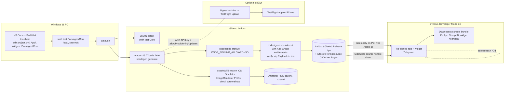

# 06 — Windows & Build Infrastructure (Phase 1 research)

**Author:** Agent 6 (Windows & Build Infrastructure). **Date:** 2026-11-11.
**Scope:** How someone with only a Windows 11 PC and an iPhone builds, tests, signs and installs a SwiftUI app + WidgetKit extension (plus a possible Live Activity in the same extension) that uses App Groups and the Spotify iOS SDK, keeping cost as low as possible.

Labels used below:
- **VERIFIED**: I read it in an official or primary source (vendor docs, or the tool's own source code) during this session. The URL is given.
- **INFERRED**: my reasoning, widely reported behavior, or a third-party source. Test it before you rely on it.

---

## 0. TL;DR recommendation

| Decision | Recommendation |
|---|---|
| Cloud Mac | **GitHub Actions `macos-26` runner (Xcode 26.6 is the default)**. In a **public repo** this is free with no minute cap. In a private repo, the Free plan's $12/month credit buys about 190 macOS minutes. Codemagic's free 500 M2 minutes/month is the backup. |
| Project definition | **XcodeGen** (`project.yml`). The `.xcodeproj` is generated on CI and never committed. |
| Spotify SDK | Use the **SPM package `https://github.com/spotify/ios-sdk`** (product `SpotifyiOS`, a binary xcframework target). Nothing needs to be vendored. |
| Artifact | Archive **unsigned**, then **ad-hoc sign inside-out with explicit entitlements files** (`codesign -s -`). Without that step the re-signer cannot see the App Group entitlement. Package as `Payload/*.app` → `.ipa`. |
| Install (free) | **SideStore** for on-device refresh (bootstrap it once from Windows with iloader), or **Sideloadly** from Windows (auto-refresh over Wi-Fi). AltStore Classic + AltServer for Windows is the fallback. |
| App Group ID | **Never hard-code it.** At runtime, resolve it from `ALTAppGroups`, then from `embedded.mobileprovision`, then the base ID. Validate each candidate with `containerURL(forSecurityApplicationGroupIdentifier:)`, which returns `nil` on iOS when the group is invalid. |
| Paid ($99/yr) | Only worth it for 1-year signing, TestFlight and push (APNs). Signing can be done fully Mac-free with an App Store Connect API key + `xcodebuild -allowProvisioningUpdates`, or an OpenSSL CSR on Windows + manual profiles. |
| Unavoidable cost | **$0** on the free path. The real costs are the 7-day re-sign cycle, the 3-app / 10-App-ID limits, and no push or TestFlight. |

---

## 1. Cloud macOS build options

### 1.1 GitHub Actions (recommended)

**Pricing now uses a dollar allowance, not a minute allowance** — VERIFIED, https://docs.github.com/en/billing/concepts/product-billing/github-actions
- Included compute per month: **GitHub Free $12**, **Pro $18**, **Team $18**, Enterprise Cloud $300. GitHub says "The included compute usage is expressed as a monetary amount, not a fixed number of minutes."
- Artifact storage: Free 500 MB, Pro 1 GB. Cache: 10 GB per repo.
- **Public repos: standard GitHub-hosted runners are free.** This usage "remains free independently and does not reduce the included compute usage". Larger runners are billed even in public repos.

**Per-minute rates** — VERIFIED, https://docs.github.com/en/billing/reference/actions-runner-pricing

| Runner | SKU | $/min |
|---|---|---|
| Linux 2-core x64 | `actions_linux` | $0.006 |
| Linux 2-core arm64 | `actions_linux_arm` | $0.005 |
| **macOS 3/4-core (M1 or Intel), standard** | `actions_macos` | **$0.062** |
| macOS 12-core (large) | `macos_l` | $0.077 |
| macOS 5-core M2 Pro (xlarge) | `macos_xl` | $0.102 |

- There is no explicit "10× multiplier" any more. macOS standard costs about 10.3× Linux. The old "minute multiplier" language now only appears on third-party sites (e.g. https://cicdpipelinecost.com/github-actions-pricing).
- **Private-repo budget** (my calculation): $12 ÷ $0.062 ≈ **193 macOS minutes/month on Free**, ≈ 290 on Pro. A typical generate + test + archive job takes 8–15 min (INFERRED), so that is roughly 13–24 builds a month. Each job is rounded up to the next whole minute (VERIFIED, same page).
- Third-party reports put macOS at $0.08 → $0.062 in January 2026, and say the self-hosted runner platform fee was proposed and then postponed (INFERRED: https://samexpert.com/github-actions-pricing-backlash-2026/, https://dev.to/shubhamoriginx/github-actions-changed-pricing-in-2026-heres-exactly-what-youre-paying-now-51db). This doesn't affect us, because we don't self-host.

**Images and Xcode** — VERIFIED, https://github.com/actions/runner-images
- `macos-26` / `macos-latest` = macOS 26 arm64. `macos-26-intel` / `macos-26-large` = x64. `macos-15` (arm64) is still available. **macOS 14 images were retired on 2026-11-02.** An `xcode-27` image label is in **preview**.
- macOS 26 arm64 image `20261102.0473.1` has **Xcode 26.6 (default), 26.5, 26.4.1, 26.3, 26.2, 26.1.1, 26.0.1** and **iOS simulator runtimes 26.2, 26.4, 26.5**. Fastlane 2.241.2 is preinstalled. **XcodeGen, Tuist and SwiftLint are not**, so install them with Homebrew or mise. VERIFIED: https://github.com/actions/runner-images/blob/main/images/macos/macos-26-arm64-Readme.md
- Image defaults change over time. The default moved 26.2 → 26.4.1 → 26.5 → 26.6 during 2026, and macos-latest moved to 26 in mid-2026 (INFERRED from release notes mirrored at https://newreleases.io/project/github/actions/runner-images/release/macos-26%2F20260720.0390). **Pin both `runs-on: macos-26` and the Xcode path explicitly.**

### 1.2 Codemagic (best free backup for a private repo)
VERIFIED, https://docs.codemagic.io/billing/pricing/
- **500 free minutes/month on macOS M2** (Mac mini M2, 8-core, 8 GB) for **personal accounts only**. Teams don't get them. The allowance resets on the 1st of each month.
- Overage, if you turn billing on: M2 $0.095/min, M4 $0.114/min. Linux and Windows builds get no free minutes.
- Third-party sites mention a 120-minute build limit and one concurrent build on the free tier (INFERRED: https://agentdeals.dev/vendor/codemagic).
- Codemagic works with GitHub repos and has its own `codemagic.yaml`. All the shell steps in §3 carry over unchanged.

### 1.3 Bitrise
VERIFIED, https://bitrise.io/plans-pricing
- **Hobby (free): "500 build minutes a month on Linux or macOS, 1 private app, and unlimited public apps"**. Builds time out after **90 min**. macOS on Hobby means the M2 Pro Medium machine.
- **You must verify a credit card.** Optional pay-as-you-go is capped at $15/month, billed at 1.5× the rate.
- Older third-party pages describe "300 credits", which comes to about 150 macOS minutes (https://toolradar.com/tools/bitrise/pricing). The official page now says 500 minutes. Use the official figure.
- The card requirement and the single private app make Bitrise less attractive than Codemagic.

### 1.4 Xcode Cloud
- Requires Apple Developer Program membership. **Includes 25 compute hours/month.** Add-ons: 100 h $49.99, 250 h $99.99, 1,000 h $399.99, 10,000 h $3,999.99 per month. VERIFIED: https://developer.apple.com/xcode-cloud/
- **You cannot set it up without a Mac.** Apple says "You need to configure your first Xcode Cloud workflow in Xcode." App Store Connect can create and edit workflows **only after the first build**. VERIFIED: https://developer.apple.com/documentation/xcode/configuring-your-first-xcode-cloud-workflow
- It also needs a committed `.xcodeproj` with shared schemes, which doesn't fit a "generate on CI" approach.
- **Verdict: not viable**, unless you rent a Mac for one hour just to click through the first workflow. Even then, GitHub Actions is simpler.

### 1.5 Rented Macs (fallback only)
- **MacinCloud** (INFERRED, third-party figures; the official pricing page didn't load): pay-as-you-go about **$1/hour**, rounded up per day; Managed Server about $25–29/month; Dedicated M4 about $125/month. Sources: https://rentamac.io/macincloud-alternatives/, https://gamefromscratch.com/pay-as-you-go-macintosh-development-a-macincloud-com-review/, https://macincloud.freshdesk.com/support/solutions/articles/8000044698-what-is-macincloud-s-pay-as-you-go-server-plan-
- Possible uses: a one-off Xcode GUI session, such as Xcode Cloud bootstrap or debugging a signing problem interactively. None is needed on the recommended path.

### 1.6 Recommendation for Q1
**GitHub Actions on `macos-26`.**
- If you can tolerate the source being public, make the repo **public**. Builds are then unlimited and free, and there are no secrets to leak (see §4.7: the Spotify client ID isn't a secret when you use PKCE).
- If the repo must be private, the Free plan's $12 credit (~190 macOS min) is enough for normal development if you:
  - run pure-Swift tests on `ubuntu-latest` ($0.006/min),
  - trigger macOS jobs only on `main` or by manual dispatch, and
  - use Codemagic's 500 free minutes as overflow.

---

## 2. Defining the project without Xcode: XcodeGen vs Tuist

| | XcodeGen | Tuist |
|---|---|---|
| Manifest | YAML/JSON `project.yml` | Swift `Project.swift` (needs Tuist's ProjectDescription framework, i.e. a Mac/Xcode to evaluate) |
| Install on CI | `brew install xcodegen` (not preinstalled) | `mise install tuist` / curl script (not preinstalled) |
| Cost | Free, MIT (https://github.com/yonaskolb/XcodeGen) | Generation is "included without metering". The company sells server features such as cache and insights on usage-based plans with a free "Air" tier. VERIFIED: https://tuist.dev/pricing |
| Editing on Windows | Plain YAML, so any editor works and there's nothing to compile | Swift manifest you can't evaluate on Windows. Errors only show up on CI. |
| Extensions, entitlements, SPM | All supported (see below) | All supported |
| Ecosystem signal | **Spotify's own iOS SDK demo apps moved to XcodeGen** in v2.1.7. VERIFIED: https://github.com/spotify/ios-sdk/releases | Larger feature set, aimed at big modular teams |

XcodeGen spec facts — VERIFIED, https://github.com/yonaskolb/XcodeGen/blob/master/Docs/ProjectSpec.md
- `entitlements: {path, properties}` generates the file and sets `CODE_SIGN_ENTITLEMENTS`.
- `info: {path, properties}` generates `Info.plist`.
- `packages:` accepts remote (`url` + `from`/`exactVersion`/…) or local (`path`) packages. A target depends on one with `- package: Name` + `product:`.
- `type: app-extension` defines an extension. An application target that depends on the extension target embeds it (`embed` defaults to true for apps). An XCFramework can be a plain `framework:` dependency.
- The newest `projectFormat` listed is `xcode27_0`.

**Spotify iOS SDK packaging** — VERIFIED
- The README says to add it via SPM, or by dropping in `SpotifyiOS.framework`/`SpotifyiOS.xcframework`. Device: arm64. Simulator: arm64 + x86_64. iOS 12+. https://github.com/spotify/ios-sdk
- `Package.swift` declares tools 5.5, iOS 12, one library product **`SpotifyiOS`**, and a **binary target pointing at the bundled `SpotifyiOS.xcframework`**. https://raw.githubusercontent.com/spotify/ios-sdk/master/Package.swift
- Latest release: **v5.0.1** (scene-based window handling, auth session cleanup). https://github.com/spotify/ios-sdk/releases
- The repo is large because the xcframework lives in git, so the first SPM resolve is slow (INFERRED). Cache `~/Library/Caches/org.swift.swiftpm` and `SourcePackages` on CI.

**Recommendation for Q2: XcodeGen.** You can edit and lint the YAML on Windows without a Mac. It handles the app + widget + App Group + SPM shape directly. Spotify uses it too. Commit `project.yml`, add `*.xcodeproj` to `.gitignore`, and run `xcodegen generate` as the first CI step.

### 2.1 Draft `project.yml` (sketch, not tested)

```yaml
name: NowPlaying
options:
  bundleIdPrefix: io.github.CHANGEME
  deploymentTarget: { iOS: "17.0" }      # interactive widgets/AppIntents need 17+
  xcodeVersion: "26.0"
  createIntermediateGroups: true
settings:
  base:
    SWIFT_VERSION: "6.0"
    MARKETING_VERSION: "0.1.0"
    CURRENT_PROJECT_VERSION: "1"         # CI overrides with run number
    CODE_SIGN_STYLE: Automatic           # ignored for unsigned builds; used by paid path
    # DEVELOPMENT_TEAM: injected by paid CI only
packages:
  SpotifyiOS:
    url: https://github.com/spotify/ios-sdk
    exactVersion: 5.0.1                  # verify the tag format resolves (tags may be 'v5.0.1')
  Core:
    path: Packages/Core                  # platform-independent SwiftPM package (builds on Windows)
targets:
  NowPlaying:
    type: application
    platform: iOS
    sources: [App, Shared]
    dependencies:
      - target: NowPlayingWidget         # embeds .appex into PlugIns/
      - package: SpotifyiOS
        product: SpotifyiOS
      - package: Core
    info:
      path: App/Info.plist
      properties:
        CFBundleDisplayName: Now Playing
        UILaunchScreen: {}
        LSApplicationQueriesSchemes: [spotify]
        CFBundleURLTypes:
          - CFBundleURLName: io.github.CHANGEME.nowplaying.spotify-auth
            CFBundleURLSchemes: [nowplaying-spotify]   # redirect: nowplaying-spotify://callback
        NSSupportsLiveActivities: true
        AppGroupBaseID: group.io.github.CHANGEME.nowplaying.shared  # read by resolver (§4.6)
    entitlements:
      path: App/NowPlaying.entitlements
      properties:
        com.apple.security.application-groups:
          - group.io.github.CHANGEME.nowplaying.shared
    settings:
      base:
        PRODUCT_BUNDLE_IDENTIFIER: io.github.CHANGEME.nowplaying
  NowPlayingWidget:
    type: app-extension
    platform: iOS
    sources: [Widget, Shared]
    dependencies:
      - package: Core
      - sdk: WidgetKit.framework
      - sdk: SwiftUI.framework
      - sdk: ActivityKit.framework
    info:
      path: Widget/Info.plist
      properties:
        CFBundleDisplayName: Now Playing Widget
        NSExtension:
          NSExtensionPointIdentifier: com.apple.widgetkit-extension
        AppGroupBaseID: group.io.github.CHANGEME.nowplaying.shared
    entitlements:
      path: Widget/NowPlayingWidget.entitlements
      properties:
        com.apple.security.application-groups:
          - group.io.github.CHANGEME.nowplaying.shared
    settings:
      base:
        PRODUCT_BUNDLE_IDENTIFIER: io.github.CHANGEME.nowplaying.widget   # must be prefixed by app ID
  NowPlayingTests:
    type: bundle.unit-test
    platform: iOS
    sources: [Tests]
    dependencies:
      - target: NowPlaying
    settings:
      base:
        TEST_HOST: "$(BUILT_PRODUCTS_DIR)/NowPlaying.app/$(BUNDLE_EXECUTABLE_FOLDER_PATH)/NowPlaying"
        BUNDLE_LOADER: "$(TEST_HOST)"
schemes:
  NowPlaying:
    build: { targets: { NowPlaying: all, NowPlayingWidget: all } }
    test: { targets: [NowPlayingTests], gatherCoverageData: false }
    archive: { config: Release }
```

Design notes (INFERRED):
- **Don't use the main app's bundle ID as the App Group ID.** SideStore has a special case for groups whose raw ID equals the bundle ID (§4.5). Use a distinct `…shared` suffix so the generic rewrite rule (`<group>.<TEAMID>`) applies the same way to both targets.
- Keep the Live Activity UI in the **same** widget extension. A second extension would cost another App ID (§4.2).
- Keep **no** `keychain-access-groups` or push entitlements in the free build (§4.6, §5).

---

## 3. Building an UNSIGNED (re-signable) .ipa on CI

### 3.1 Key pitfall: entitlements live in the code signature
- AltStore's signing library reads an app's entitlements from the **binary's code signature** using ldid. The `entitlementsString` getter calls `ldid::Entitlements(self.fileURL...)`. VERIFIED: https://raw.githubusercontent.com/rileytestut/AltSign/master/AltSign/Model/ALTApplication.mm
- AltStore turns App ID features (including `.appGroups`) on or off depending on whether the app declares those entitlements. VERIFIED: https://raw.githubusercontent.com/altstoreio/AltStore/master/AltStore/Operations/FetchProvisioningProfilesOperation.swift
- The signer then signs each bundle with **the provisioning profile's entitlements** and writes a separate `embedded.mobileprovision` into **each** bundle, extensions included. VERIFIED: https://raw.githubusercontent.com/rileytestut/AltSign/master/AltSign/Signing/ALTSigner.mm
- AltStore source manifests must list every entitlement the app and its extensions use, and "AltStore checks these against the .ipa". VERIFIED: https://faq.altstore.io/developers/make-a-source
- With `CODE_SIGNING_ALLOWED=NO`, Xcode doesn't run codesign, so **no entitlements are embedded** (INFERRED; standard Xcode behavior, also noted in https://ptkd.com/journal/altstore-invalid-code-signature-fix). The re-signer then sees no App Group and never enables it. The app and widget each get no group, and `containerURL` returns `nil`.
- **Fix:** after the unsigned archive, **ad-hoc sign (`-s -`) inside-out with explicit entitlements files**. Ad-hoc signatures carry entitlements and are easy for any re-signer to replace. The `ldid -S`/`codesign --entitlements` approach is the same as in https://georgegarside.com/blog/ios/custom-entitlement-ios-app-ipa/ (INFERRED for our exact use).
- **The entitlements files used for the ad-hoc step must contain literal values.** `$(AppIdentifierPrefix)`/`$(TeamIdentifierPrefix)` aren't expanded when you call `codesign` yourself. Avoid them in the free build.

### 3.2 Exact commands (run on the macOS runner)

```bash
set -euo pipefail
xcodegen generate

# 1) Unsigned archive (device SDK)
xcodebuild archive \
  -project NowPlaying.xcodeproj -scheme NowPlaying -configuration Release \
  -destination 'generic/platform=iOS' \
  -archivePath build/NowPlaying.xcarchive \
  CODE_SIGNING_ALLOWED=NO CODE_SIGNING_REQUIRED=NO CODE_SIGN_IDENTITY="" \
  CURRENT_PROJECT_VERSION="${GITHUB_RUN_NUMBER:-1}"

APP="build/NowPlaying.xcarchive/Products/Applications/NowPlaying.app"
test -d "$APP/PlugIns/NowPlayingWidget.appex"     # pitfall: assert the extension was embedded

# 2) Ad-hoc sign inside-out so the re-signer can read entitlements
#    (nested frameworks/dylibs first, then each .appex, then the app)
find "$APP" -depth \( -name '*.framework' -o -name '*.dylib' \) -print0 |
  xargs -0 -I{} codesign --force --sign - --timestamp=none "{}"
codesign --force --sign - --timestamp=none \
  --entitlements Config/adhoc/Widget.entitlements "$APP/PlugIns/NowPlayingWidget.appex"
codesign --force --sign - --timestamp=none \
  --entitlements Config/adhoc/App.entitlements "$APP"

# 3) Verify (fail the build if the group is missing)
codesign -d --entitlements - --xml "$APP" | grep -q 'application-groups'
codesign -d --entitlements - --xml "$APP/PlugIns/NowPlayingWidget.appex" | grep -q 'application-groups'

# 4) Package: Payload/NowPlaying.app -> .ipa (ditto preserves symlinks/permissions)
rm -rf build/ipa && mkdir -p build/ipa/Payload
cp -R "$APP" build/ipa/Payload/
(cd build/ipa && ditto -c -k --sequesterRsrc --keepParent Payload ../NowPlaying-unsigned.ipa)
```

`Config/adhoc/App.entitlements` and `Widget.entitlements` contain only:
```xml
<?xml version="1.0" encoding="UTF-8"?>
<!DOCTYPE plist PUBLIC "-//Apple//DTD PLIST 1.0//EN" "http://www.apple.com/DTDs/PropertyList-1.0.dtd">
<plist version="1.0"><dict>
  <key>com.apple.security.application-groups</key>
  <array><string>group.io.github.CHANGEME.nowplaying.shared</string></array>
</dict></plist>
```

### 3.3 Other pitfalls (INFERRED unless noted)
- **The widget bundle ID must be prefixed by the app's bundle ID.** Otherwise installs fail with "Failed to set app extension placeholders". Third-party report: https://www.appsonair.com/blogs/managing-multiple-bundle-ids-correctly-the-complete-ios-developer-guide
- **Leave `.xctest` bundles out of the archive.** AltStore deletes `.xctest` bundles in DEBUG builds anyway (VERIFIED, ResignAppOperation source, §4.5). Ship `Release`.
- **Don't run `codesign --deep`.** It applies the app's entitlements to nested code.
- Re-signers need a real `CFBundleVersion`/`CFBundleShortVersionString`. Bump `CURRENT_PROJECT_VERSION` every build so SideStore/AltStore sources see updates.
- **Re-run the "verify" step after any refactor.** It's the cheapest guard against a silent App Group loss.
- An `xcodebuild` alternative is `CODE_SIGN_IDENTITY=- CODE_SIGN_STYLE=Manual AD_HOC_CODE_SIGNING_ALLOWED=YES`, which lets Xcode ad-hoc sign with the processed entitlements. It may fail for iOS device targets that need a team (INFERRED, untested), so the explicit `codesign` step is the safer choice.

---

## 4. Installing on the iPhone from Windows with a FREE Apple ID

### 4.1 Requirements common to all tools
- **Developer Mode** must be on (iOS 16+): Settings → Privacy & Security → Developer Mode, then restart. AltStore: "you need to enable Developer Mode on your device" (VERIFIED, https://faq.altstore.io/altstore-classic/how-to-install-altstore-windows). Sideloadly FAQ says the same (VERIFIED, https://sideloadly.io/faq).
- **iTunes/iCloud for Windows:**
  - Sideloadly "requires the **web version** of iTunes & iCloud". Remove the Microsoft Store versions. VERIFIED: https://sideloadly.io/
  - AltServer: "Download and install the latest version of iTunes and iCloud directly from Apple (not the Microsoft Store)". There's a troubleshooting workaround for the Store iCloud. VERIFIED: https://faq.altstore.io/altstore-classic/how-to-install-altstore-windows
  - SideStore/iloader: iTunes from the Store or Apple's site, with Apple's version recommended; the "Apple Devices" app is a fallback. iCloud isn't listed. Windows must be 64-bit, and Windows-on-ARM isn't supported. VERIFIED: https://docs.sidestore.io/docs/installation/prerequisites
- **Use a secondary Apple ID** for sideloading. All three tools need your Apple ID password, and you enter it into the tool yourself (INFERRED, best practice).

### 4.2 Free Apple Account limits
- Apple says: "You can register up to 10 App IDs, which expire after 7 days. You can register up to 3 devices… You can install up to 3 apps per device." VERIFIED: https://developer.apple.com/support/compare-memberships/
- **Each extension consumes its own App ID.** The App IDs an app needs depend on "the number of app extensions each app contains", and each App ID "expires after one week". VERIFIED: https://faq.altstore.io/altstore-classic/app-ids
- **Our app costs 2 App IDs** (app + widget; a Live Activity in the same extension adds none). That allows at most 5 fresh installs of distinct apps per rolling week.
  - Refreshing or re-installing the **same** bundle IDs reuses existing IDs (INFERRED).
  - **Changing the bundle ID burns new IDs.**
- **3 active apps:** SideStore/AltStore count themselves ("3 apps (including itself)"; VERIFIED, https://docs.sidestore.io/docs/faq). With SideStore you have 2 slots left; with Sideloadly, 3.
  - Whether an extension's separate profile counts toward the 3-app limit is **unclear** (INFERRED). Check on the first install.
- **Expiry: 7 days.** Apps must be re-signed before then, or they stop launching (VERIFIED, Sideloadly FAQ).
- Not available on free teams: **Push Notifications and iCloud**. Xcode's error says "Personal development teams do not support the Push Notifications capability". Push is supported for paid ADP/ADEP but not for free provisioning. VERIFIED (Apple forums): https://developer.apple.com/forums/thread/768748, https://developer.apple.com/forums/thread/811929
  - So **push-to-update Live Activities and remote widget pushes are impossible on the free path.** Local updates from the running app still work (INFERRED).
- An unverified claim that free teams are capped at 3 App Groups exists: https://ptkd.com/journal/altstore-invalid-code-signature-fix (cites SideStore issue #782). We only need 1.

### 4.3 Tool status (late 2026)

| Tool | Status | Refresh | Notes |
|---|---|---|---|
| **Sideloadly** | v0.71.0, active; "Supports iOS 7 … up to iOS 27+". VERIFIED: https://sideloadly.io/, https://sideloadly.io/changelog | Background daemon on the PC re-signs "every few days". Needs the PC on, same network, Wi-Fi sync set up, and the phone screen on. VERIFIED: https://sideloadly.io/faq | Can remove PlugIns, change the bundle ID, and (Patreon + paid account only) set custom entitlements. App Group rewriting **isn't documented**. |
| **SideStore** | Active fork of AltStore, "doesn't require an AltServer". iOS 15+ (docs) / 14+ (intro). VERIFIED: https://github.com/SideStore/SideStore, https://docs.sidestore.io/docs/installation/prerequisites | **On-device** background refresh via the **LocalDevVPN** app (loopback VPN, "only connecting to your own device"). Needs Wi-Fi. VERIFIED: https://docs.sidestore.io/docs/faq | You need the PC only once, to install SideStore with **iloader** (Windows MSI/EXE). It can subscribe to a "source" JSON, so CI releases auto-update (§4.8). |
| **AltStore Classic + AltServer (Windows)** | Classic is "Available Worldwide"; PAL is EU/Japan/Brazil only. VERIFIED: https://faq.altstore.io/altstore-pal-v.-altstore-classic | Over Wi-Fi with AltServer running on the PC (same network) | App Group handling is documented in source (§4.5). Uses 1 of the 3 slots. |

### 4.4 How bundle IDs change
- **AltStore:** the new ID is `<originalParentID>.<TEAMID>` and extensions keep their suffix. `updatedParentBundleID = parentBundleID + "." + team.identifier`. VERIFIED: FetchProvisioningProfilesOperation.swift above.
- **SideStore:** `parentID = "\(targetBundleIdentifier).\(team.identifier)"`, then `bundleID = parentID + suffix` for extensions. VERIFIED: https://raw.githubusercontent.com/SideStore/SideStore/develop/SideStore/Core/Operations/PipelineOperations/FetchProvisioningProfilesOperation.swift
- **Sideloadly:** keeps the ID unless it has to change it ("we are forced to set a unique bundle ID" when it conflicts). Mangling is tied to its anisette option. You can set a custom ID. VERIFIED: https://sideloadly.io/faq, https://sideloadly.io/changelog
  - To minimize mangling, pick a globally unique reverse-DNS ID (INFERRED).

### 4.5 How App Groups are rewritten (critical)
- **AltStore Classic** (VERIFIED, source):
  - Each group becomes `groupIdentifier + "." + team.identifier`. If missing, it's registered on the team as "AltStore <group with spaces>".
  - When re-signing **each bundle (app and every extension)**, it writes the profile's groups into Info.plist under **`ALTAppGroups`**. It also writes `ALTBundleIdentifier` (the original bundle ID).
  - Sources: https://raw.githubusercontent.com/altstoreio/AltStore/master/AltStore/Operations/ResignAppOperation.swift, https://raw.githubusercontent.com/altstoreio/AltStore/master/Shared/Extensions/Bundle%2BAltStore.swift
- **SideStore** (VERIFIED, source, `develop` branch):
  - Generic rule: `groupIdentifier + "." + team.identifier`.
  - Special case: a group whose raw ID equals the bundle ID becomes `"group." + appID.bundleIdentifier`. That's why §2.1 uses a distinct `.shared` group.
  - **This fork's ResignAppOperation doesn't write `ALTAppGroups`** into Info.plist. It reads profile groups only to remap `NSExtensionFileProviderDocumentGroup`.
  - Source: https://raw.githubusercontent.com/SideStore/SideStore/develop/SideStore/Core/Operations/PipelineOperations/ResignAppOperation.swift
  - **Don't rely on `ALTAppGroups` alone.**
- **Sideloadly:** undocumented (INFERRED). Assume it either keeps the original group (possible if the ID is globally unique and free for your team) or rewrites it. Runtime discovery (below) covers both cases.
- In all cases, **both the app and the widget are signed by the same team in one pass**, so they end up with the **same** rewritten group. The task is to have both sides discover that one string the same way.

### 4.6 Runtime App Group discovery (drop into `Shared/`, compiled into both targets)
- On iOS, `containerURL(forSecurityApplicationGroupIdentifier:)` returns `nil` when the group identifier is invalid. VERIFIED: https://developer.apple.com/documentation/foundation/filemanager/containerurl(forsecurityapplicationgroupidentifier:)
- Every development-signed bundle (app and appex) contains its own `embedded.mobileprovision`. VERIFIED: ALTSigner writes one per bundle.

```swift
import Foundation

enum AppGroup {
    /// Base ID as authored; also stored in Info.plist key AppGroupBaseID.
    static let baseID = (Bundle.main.object(forInfoDictionaryKey: "AppGroupBaseID") as? String)
        ?? "group.io.github.CHANGEME.nowplaying.shared"

    /// The group this signed binary is actually entitled to. Same algorithm in app + widget.
    static let id: String = {
        var candidates: [String] = []
        if let alt = Bundle.main.object(forInfoDictionaryKey: "ALTAppGroups") as? [String] { candidates += alt } // AltStore
        candidates += EmbeddedProfile.current?.appGroups ?? []                                                  // any dev-signed re-signer
        candidates.append(baseID)                                                                               // TestFlight / paid / unmodified
        let ordered = candidates.filter { $0.hasPrefix(baseID) } + candidates                                   // prefer "<base>.<TEAMID>"
        return ordered.first { FileManager.default.containerURL(forSecurityApplicationGroupIdentifier: $0) != nil } ?? baseID
    }()

    static var defaults: UserDefaults? { UserDefaults(suiteName: id) }
    static var containerURL: URL? { FileManager.default.containerURL(forSecurityApplicationGroupIdentifier: id) }
}

struct EmbeddedProfile {
    let appGroups: [String]; let teamID: String?
    static let current: EmbeddedProfile? = {
        guard let url = Bundle.main.url(forResource: "embedded", withExtension: "mobileprovision"),
              let data = try? Data(contentsOf: url),
              let start = data.range(of: Data("<?xml".utf8)),
              let end = data.range(of: Data("</plist>".utf8), in: start.lowerBound..<data.endIndex),
              let plist = try? PropertyListSerialization.propertyList(
                    from: data.subdata(in: start.lowerBound..<end.upperBound), format: nil) as? [String: Any]
        else { return nil } // App Store / TestFlight builds have no embedded profile → falls back to baseID
        let ent = plist["Entitlements"] as? [String: Any]
        return EmbeddedProfile(appGroups: ent?["com.apple.security.application-groups"] as? [String] ?? [],
                               teamID: (plist["TeamIdentifier"] as? [String])?.first)
    }()
}
```
- Add a hidden **Diagnostics** screen that shows `Bundle.main.bundleIdentifier`, `AppGroup.id`, `EmbeddedProfile.current?.teamID` and whether `AppGroup.containerURL` is non-nil. Have the widget write a heartbeat into the group that the app displays. This is the first-install acceptance test (§8).

**Keychain access groups after re-signing (INFERRED):**
- The team prefix changes to your free team's ID. A hard-coded `kSecAttrAccessGroup` such as `ABCDE12345.com.x.shared` will fail.
- Recommended: **keep Spotify tokens in the app's default keychain (no access group)** and never read them from the widget. The widget only reads a non-secret "now playing" snapshot from the App Group container.
- If you ever need a shared keychain, discover the prefix at runtime. Add a probe item without `kSecAttrAccessGroup`, read back its `kSecAttrAccessGroup` (format `TEAMID.bundleid`), and take the first component. Shared keychain groups also need a `keychain-access-groups` entitlement that the re-signer must grant. Avoid it.

### 4.7 URL schemes and Spotify
- **URL schemes survive re-signing.**
  - AltStore *appends* its own scheme entry to the existing `CFBundleURLTypes`. VERIFIED, ResignAppOperation.swift.
  - SideStore loads the existing `CFBundleURLTypes`, removes only `sidestore-` entries, and appends its own. VERIFIED, SideStore ResignAppOperation.swift.
  - Sideloadly: not documented, but it has no reason to touch them (INFERRED).
  - So a redirect URI like `nowplaying-spotify://callback` keeps working.
- **Spotify dashboard.** You register a redirect URI and a **Bundle ID** ("your iOS app bundle identifier"), and add `spotify` to `LSApplicationQueriesSchemes`. VERIFIED: https://developer.spotify.com/documentation/ios/getting-started
- After AltStore/SideStore re-signing, the bundle ID becomes `io.github.CHANGEME.nowplaying.<TEAMID>`.
  - Whether Spotify enforces the bundle ID during the app-switch auth flow isn't documented (INFERRED: it may).
  - **Mitigation:** read the real ID from the Diagnostics screen after the first install and add it in the dashboard, keeping the original too. It stays stable as long as you use the same Apple ID/team.
- The redirect URI (custom scheme) is independent of the bundle ID.
- Use **PKCE / the SDK's token-swap-less flow**, so no client secret ships in the app or the repo. That makes a public repo safe (INFERRED; Agent covering Spotify should confirm).

### 4.8 Getting the IPA onto the phone
- **Sideloadly:** download the `NowPlaying-unsigned.ipa` artifact on the PC (GitHub artifacts download as a .zip; unzip first), drag it into Sideloadly, sign in with your Apple ID, then Start. Turn on the auto-refresh daemon.
- **SideStore:**
  - Simplest: open the IPA from Files/Safari on the phone and share it to SideStore.
  - Better: CI publishes a **GitHub Release** (public repo, so direct download URLs work) and updates an **AltStore-format source JSON** on GitHub Pages. Add that source in SideStore and updates appear on the phone.
  - Required fields: source `name`, `apps[]` with `name`, `bundleIdentifier`, `developerName`, `localizedDescription`, `iconURL`, `versions[]` (`version`, `buildVersion`, `date`, `downloadURL`, `size`), and **`appPermissions.entitlements`** listing `com.apple.security.application-groups`. VERIFIED: https://faq.altstore.io/developers/make-a-source
- Private repo: release assets need auth. Download on the PC and use Sideloadly, or move the file to the phone via iCloud Drive or OneDrive.

---

## 5. PAID path ($99/yr Apple Developer Program)

**Price and waivers** — VERIFIED, https://developer.apple.com/programs/enroll/
- "99 USD per membership year" (local pricing varies). You can enroll on the web or in the **Apple Developer app**, which runs on iPhone, so no Mac is needed.
- Fee waivers are only for **nonprofits, accredited educational institutions and government entities** (https://developer.apple.com/support/fee-waiver/), not individuals.

**What it unlocks**
- Certificates, Identifiers & Profiles, and App Store Connect. VERIFIED: https://developer.apple.com/support/compare-memberships/
- **TestFlight:** up to 100 internal testers, 30 devices per tester. VERIFIED: https://developer.apple.com/testflight/. Builds expire after 90 days (INFERRED, well known).
- **Push/APNs, iCloud.** Paid only per the forum evidence above.
- **Xcode Cloud 25 h/month** (but setup needs a Mac).
- Development/ad-hoc profiles valid about **1 year**, and no 10-App-ID weekly cap (INFERRED, widely documented).
- The App Group is registered once under **your** team, so the bundle ID and group stay exactly as authored. The runtime resolver simply returns `baseID`.

**Mac-free signing on CI — Option A (simplest): automatic provisioning with an App Store Connect API key**
- `-allowProvisioningUpdates` makes xcodebuild "create and update profiles, app IDs, and certificates" for automatically signed targets. It does nothing for `CODE_SIGN_STYLE=Manual`.
- Known traps:
  - The key needs **Admin** role.
  - **"Access to Cloud Managed Distribution Certificate"** must be enabled for the account in App Store Connect → Users and Access.
  - Flags must be passed as separate args, not `-authenticationKeyID=XX`.
  - Fresh-runner failures have been reported.
- VERIFIED-as-reports (Apple forums): https://developer.apple.com/forums/thread/764554, https://developer.apple.com/forums/thread/695759, https://developer.apple.com/forums/thread/776036

```bash
# secrets: ASC_KEY_ID, ASC_ISSUER_ID, ASC_KEY_P8 (contents), TEAM_ID
echo "$ASC_KEY_P8" > "$RUNNER_TEMP/AuthKey.p8"
AUTH=(-allowProvisioningUpdates -authenticationKeyPath "$RUNNER_TEMP/AuthKey.p8"
      -authenticationKeyID "$ASC_KEY_ID" -authenticationKeyIssuerID "$ASC_ISSUER_ID")
xcodebuild archive -project NowPlaying.xcodeproj -scheme NowPlaying -configuration Release \
  -destination 'generic/platform=iOS' -archivePath build/NowPlaying.xcarchive \
  DEVELOPMENT_TEAM="$TEAM_ID" CODE_SIGN_STYLE=Automatic "${AUTH[@]}"
xcodebuild -exportArchive -archivePath build/NowPlaying.xcarchive \
  -exportOptionsPlist Config/ExportOptions-AppStore.plist -exportPath build/export "${AUTH[@]}"
# ExportOptions: method=app-store-connect, destination=upload, teamID=$TEAM_ID, signingStyle=automatic
```

**Option B: manual certificate made on Windows** (more robust on ephemeral runners)
- Apple documents Keychain Access for CSRs, but also gives **OpenSSL** command-line CSR examples on the same page. VERIFIED: https://developer.apple.com/help/account/certificates/create-a-certificate-signing-request
- Git for Windows ships `openssl`:
  ```bash
  openssl genrsa -out dist.key 2048
  openssl req -new -key dist.key -out dist.csr -subj "/emailAddress=you@example.com/CN=Your Name/C=US"
  # upload dist.csr in the browser: developer.apple.com → Certificates → Apple Distribution; download .cer
  openssl x509 -inform DER -in distribution.cer -out distribution.pem
  openssl pkcs12 -export -legacy -inkey dist.key -in distribution.pem -out dist.p12   # -legacy: macOS `security import` may reject OpenSSL 3 default PBE (INFERRED)
  ```
- Next steps:
  - Create the App IDs (app + widget), the App Group, and an App Store profile per bundle in the browser.
  - Store the base64 `.p12` and profiles as GitHub secrets.
  - On CI, import into a temporary keychain and build with `CODE_SIGN_STYLE=Manual`.
- Creating certificates through the **API** (`POST /v1/certificates`) has reported **403 failures since ~January 2026** even with Admin keys (open thread: https://developer.apple.com/forums/thread/825289). Prefer the browser upload.

**Option C: fastlane match.**
- Git/GCS/S3 storage, encrypted with `MATCH_PASSWORD`. Accepts `api_key_path`. "We recommend to always use `readonly` mode when running fastlane on CI". VERIFIED: https://docs.fastlane.tools/actions/match/
- Match must create the certs once. Run it non-readonly on a CI job, since fastlane is preinstalled on `macos-26`.
- Overkill for one developer. A or B is enough.

**Install via TestFlight:** upload from CI (export with `destination=upload`, or `fastlane pilot`), add yourself as an internal tester, install the TestFlight app on the iPhone. No Windows tool and no weekly refresh.

---

## 6. Windows editing & local feedback loop

- **Swift on Windows:** Swift **6.4.2** for x86_64 and arm64.
  - Install with `winget install --id Swift.Toolchain -e --source winget`.
  - Prerequisites: VS 2022 Community with the Windows 11 SDK (22621) and VC tools.
  - **VS Code Swift extension** ("debugging and test support") or any LSP editor via SourceKit-LSP.
  - VERIFIED: https://www.swift.org/install/windows/
  - The extension supports **XCTest and Swift Testing** in Test Explorer. VERIFIED: https://code.visualstudio.com/docs/languages/swift
  - Older Windows debugger issues (CodeLLDB on ARM64; use the bundled lldb-dap) are documented on the forums: https://forums.swift.org/t/vs-code-wont-run-swift-on-windows/72721 (INFERRED that some may remain).
- **What compiles on Windows** (INFERRED, from the platform SDK split):
  - Foundation-based models, Codable parsing, state machines, timeline-entry builders, formatters.
  - **Not** SwiftUI, WidgetKit, ActivityKit, UIKit, Combine, AppIntents, or the Spotify SDK. These are Apple-SDK-only.
  - Structure the repo so **`Packages/Core`** (SwiftPM, `swift-tools-version: 6.0`, platforms `.iOS(.v17)`) imports only Foundation. Guard any Apple-only API with `#if canImport(...)`.
  - Run `swift test --package-path Packages/Core` locally on Windows **and** on `ubuntu-latest` in CI (cheap or free).
- **SourceKit-LSP** will show errors on files in `App/` and `Widget/` because it can't resolve `import SwiftUI`. That's expected. Treat CI as the compiler for those folders.
- **Visual QA without a device:**
  - `ImageRenderer` (iOS 16+) "creates images from SwiftUI views" via `uiImage`/`cgImage`/`scale`. Core Animation-composited views render as placeholders. VERIFIED: https://developer.apple.com/documentation/swiftui/imagerenderer
  - In a unit test hosted in the simulator, render each widget family view (systemSmall/Medium, accessory*, Live Activity lock-screen view) with fixture data at `scale = 3`. Write PNGs to a host path passed via `TEST_RUNNER_SNAPSHOT_DIR` (xcodebuild forwards `TEST_RUNNER_`-prefixed env vars to the test process; INFERRED, from the xcodebuild man page). The simulator shares the host filesystem, so the PNGs land in the workspace.
  - Alternatively, use `XCTAttachment` and extract from the `.xcresult` (`xcrun xcresulttool export attachments`, Xcode 16+; INFERRED).
  - Optionally add `pointfreeco/swift-snapshot-testing` for regression diffs.
  - Full-app screenshots: `xcrun simctl boot`, install the simulator build, launch with a `-UITestFixture` argument, then `xcrun simctl io booted screenshot shot.png`. Or use XCUITest + attachments.
  - Upload everything with `actions/upload-artifact` (mind the 500 MB Free-plan artifact quota in private repos; set `retention-days`). Write a Markdown gallery into `$GITHUB_STEP_SUMMARY`.
  - **Real widget placement on the Home Screen can't be tested in CI.** That's checked on the device.

---

## 7. Spotify SDK and the simulator

- VERIFIED: "You must use a physical iOS device to test the iOS SDK as the Spotify app cannot be installed on a simulator." https://developer.spotify.com/documentation/ios/getting-started
- App Remote works only with the Spotify app installed and handles playback. Music must be playing for `SPTAppRemote` to connect. Premium is needed for on-demand play by URI. VERIFIED: https://github.com/spotify/ios-sdk
- Spotify staff point no-app scenarios to the Web API. Forum: https://community.spotify.com/t5/Spotify-for-Developers/Does-Spotify-App-Remote-work-without-physical-Spotify-iOS-app/td-p/5024656
- The **xcframework includes simulator slices**, so the app **builds and launches** on the simulator. Only runtime App Remote calls fail.

**Implications:**
- Put App Remote behind a `PlayerControlling` protocol in `Core`. Implement it with:
  - `SpotifyAppRemoteController` (device only),
  - `FakePlayerController` (tests, simulator, screenshots), and
  - optionally a Web API controller.
- CI and simulator tests cover the state machine, parsing, widget rendering and the App Group plumbing. **Auth and App Remote are covered only by the on-device checklist (§8).**
- Gate on `UIApplication.shared.canOpenURL(URL(string: "spotify:")!)` (needs `LSApplicationQueriesSchemes: [spotify]`) so the simulator build degrades gracefully.

---

## 8. Recommended pipeline



### 8.1 Draft `.github/workflows/ios.yml` (sketch)

```yaml
name: ios
on:
  push: { branches: [main] }
  pull_request:
  workflow_dispatch:
concurrency: { group: ios-${{ github.ref }}, cancel-in-progress: true }

jobs:
  core-tests:                     # cheap: Linux
    runs-on: ubuntu-latest
    steps:
      - uses: actions/checkout@v4
      - run: swift --version && swift test --package-path Packages/Core

  ios:
    needs: core-tests
    runs-on: macos-26
    timeout-minutes: 40
    env:
      XCODE_APP: /Applications/Xcode_26.6.app
    steps:
      - uses: actions/checkout@v4
      - run: sudo xcode-select -s "$XCODE_APP" && xcodebuild -version
      - run: brew install xcodegen && xcodegen generate
      - uses: actions/cache@v4
        with:
          path: |
            ~/Library/Caches/org.swift.swiftpm
            build/SourcePackages
          key: spm-${{ runner.os }}-${{ hashFiles('project.yml') }}
      - name: Pick a simulator
        id: sim
        run: |
          UDID=$(xcrun simctl list devices available -j | /usr/bin/python3 -c \
            "import json,sys;d=json.load(sys.stdin)['devices'];print(next(x['udid'] for k,v in sorted(d.items(),reverse=True) if 'iOS' in k for x in v if x['name'].startswith('iPhone')))")
          echo "udid=$UDID" >> "$GITHUB_OUTPUT"
      - name: Unit + render tests (simulator)
        env:
          TEST_RUNNER_SNAPSHOT_DIR: ${{ github.workspace }}/build/renders
        run: |
          mkdir -p build/renders
          xcodebuild test -project NowPlaying.xcodeproj -scheme NowPlaying \
            -destination "id=${{ steps.sim.outputs.udid }}" \
            -clonedSourcePackagesDirPath build/SourcePackages \
            -resultBundlePath build/Tests.xcresult CODE_SIGNING_ALLOWED=NO
      - name: Unsigned archive -> ad-hoc entitlements -> IPA
        run: ./scripts/make-unsigned-ipa.sh      # the §3.2 script
      - uses: actions/upload-artifact@v4
        if: always()
        with: { name: renders, path: build/renders, retention-days: 14 }
      - uses: actions/upload-artifact@v4
        with: { name: NowPlaying-unsigned-ipa, path: build/NowPlaying-unsigned.ipa, retention-days: 14 }
      - name: Render gallery in job summary
        if: always()
        run: for f in build/renders/*.png; do echo "- $(basename "$f")" >> "$GITHUB_STEP_SUMMARY"; done
      # Optional (public repo): on tag push, create a GitHub Release with the .ipa and
      # regenerate docs/source.json (AltStore source format) for SideStore auto-updates.
```

Notes:
- Action major versions (`checkout@v4`, `upload-artifact@v4`, `cache@v4`) are current as far as I know (INFERRED). Check for newer majors when implementing.
- The simulator picker avoids hard-coding device names such as "iPhone 17", which change between Xcode versions.

### 8.2 Codemagic equivalent (backup)
In `codemagic.yaml`, set `workflows.ios.instance_type: mac_mini_m2` and pin `environment.xcode: 26.6`. Run the same `scripts:` steps (`brew install xcodegen`, `xcodegen generate`, `xcodebuild test`, `./scripts/make-unsigned-ipa.sh`) and list `artifacts: [build/*.ipa, build/renders/*.png]`. These keys are INFERRED from Codemagic's documented YAML format; verify at https://docs.codemagic.io/.

---

## 9. FREE vs PAID comparison

| | **FREE path** | **PAID path** |
|---|---|---|
| Cash cost | **$0** | **$99/yr** Apple Developer Program (+ $0 CI if public repo) |
| CI | GitHub Actions: public repo free on standard runners; private repo $12/mo credit ≈ 193 macOS min. Codemagic: 500 M2 min/mo free (personal). Bitrise: 500 min, 1 private app, card verification. | Same, plus Xcode Cloud 25 h/mo (needs a Mac for first setup, so not usable here) |
| Signing | Re-signed on install by Sideloadly / SideStore / AltStore with a free Apple ID | CI signs with your team (API key or p12). Bundle ID and App Group stay exactly as authored. |
| Validity | **7 days.** Needs auto-refresh (Sideloadly daemon + PC on the same Wi-Fi, or SideStore + LocalDevVPN on the phone). | About 1 year for dev/ad-hoc. TestFlight builds 90 days (INFERRED) with easy re-upload. |
| App limits | 3 active apps per device (SideStore/AltStore take 1). **10 App IDs per 7 days; our app uses 2.** | No practical limits |
| App Group | Works, but the ID is **rewritten** (`<group>.<TEAMID>` on AltStore/SideStore). Needs the runtime resolver. | Works as authored |
| Push / APNs, iCloud | **Not available** | Available (push-updated Live Activities possible) |
| TestFlight | No | Yes |
| Spotify dashboard | Register the **re-signed bundle ID** shown in Diagnostics | Register the authored bundle ID |
| Windows tools | iTunes (+ iCloud for Sideloadly/AltServer) **from Apple's site**, Sideloadly or iloader/AltServer | None (TestFlight app on the phone). OpenSSL from Git for Windows only if you choose manual certs. |
| Risk | Tool breakage after Apple changes; giving a third-party tool your Apple ID password | Low |

---

## 10. First-install guide (outline)

1. **Accounts.** GitHub account. Optionally a secondary Apple ID for sideloading. Spotify developer app: set the redirect URI `nowplaying-spotify://callback` and the bundle ID `io.github.CHANGEME.nowplaying`, and add the re-signed one after step 8.
2. **Windows setup.**
   - Install Git and VS Code + Swift extension.
   - Install the Swift 6.4.x toolchain via winget (with the VS 2022 components).
   - Install **iTunes (and iCloud, for Sideloadly/AltServer) from Apple's website**, uninstalling the Microsoft Store versions.
   - Install Sideloadly, or iloader for SideStore.
3. **Repo.** Create it from the skeleton (`project.yml`, `App/`, `Widget/`, `Shared/AppGroup.swift`, `Packages/Core`, `Config/adhoc/*.entitlements`, `scripts/make-unsigned-ipa.sh`, `.github/workflows/ios.yml`). Run `swift test --package-path Packages/Core` locally.
4. **Push → CI.** Check that the `ios` job is green, the `renders` artifact shows the widget PNGs, and the IPA's entitlements were verified in the log.
5. **iPhone prep.**
   - Connect by USB, unlock, and trust the PC.
   - In iTunes, enable "Wi-Fi sync" (needed for refresh).
   - After the first sideload, enable **Settings → Privacy & Security → Developer Mode** and restart.
6. **Install** (choose one).
   - **Sideloadly:** drag in the IPA, enter your Apple ID in Sideloadly, Start. Trust the developer profile in Settings → General → VPN & Device Management. Enable the auto-refresh daemon.
   - **SideStore:** install LocalDevVPN, run iloader on the PC to install SideStore, sign in within SideStore. Then import the IPA (share sheet) or add your source URL.
7. **First launch.** Open the app → Diagnostics. Confirm the App Group container is non-nil. Add the widget to the Home Screen and confirm the widget heartbeat appears in the app.
8. **Spotify.** Copy the bundle ID shown in Diagnostics into the Spotify dashboard if it differs. Install Spotify, start playback, connect, and check App Remote and the auth redirect.
9. **Weekly.** Make sure the refresh has run (PC on, or the SideStore VPN active). Remember each *new* bundle ID uses 2 of the 10 weekly App IDs, so **never change bundle IDs casually**.
10. **(Optional) Paid upgrade.** Enroll via the Apple Developer app. Add the ASC API key secrets, switch CI to the signed archive + TestFlight upload, and install with TestFlight.

---

## 11. Open items for other agents / later phases
- Sideloadly's App Group behavior is undocumented. Confirm empirically during the first install using the Diagnostics screen.
- Whether extension profiles count toward the 3-app device limit (INFERRED unknown).
- Whether Spotify's SSO validates the bundle ID against the dashboard (INFERRED). Plan for registering both IDs.
- Interactive-widget `AppIntent`s run in the extension process and can't use App Remote (INFERRED). Agent covering widget/Spotify architecture should design "open app to act" or a Web API fallback.
- Re-check GitHub runner image defaults (Xcode 27 GA timing) before Phase 2 pins versions.
